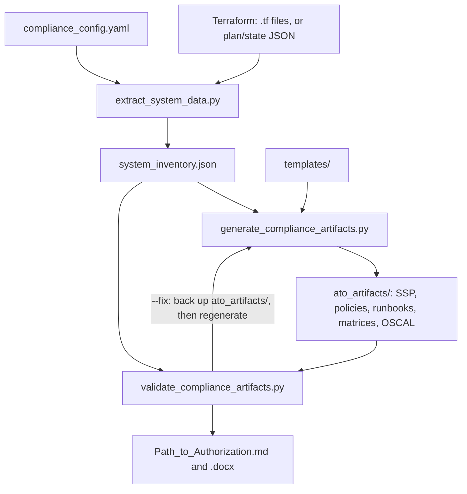

<!-- skip boilerplate check -->
# Compliance skill (`compliance_engine`)

This skill drafts Authorization to Operate (ATO) documents for one Stellar Engine blueprint. It
statically parses the blueprint's local Terraform (`.tf`, `.tfvars`, `.tfstate`, `tfplan.json`) and
application manifests, fills the templates in `templates/`, and writes Markdown, Word
(`.docx`), YAML, macro-enabled Excel (`.xlsm`), and NIST OSCAL (JSON/YAML) files to
`<TARGET_FOLDER>/ato_artifacts/`. The engine supports 11 NIST SP 800-53 Rev. 5 regimes from vendored
baseline catalogs (`config/baselines/`): `FedRAMP Low` (156 controls), `FedRAMP Moderate` (323),
`FedRAMP High` (410), `FISMA Low` (149), `FISMA Moderate` (287), `FISMA High` (370), `DoD IL2` (323),
`DoD IL4` (334), `DoD IL5` (624), `DoD IL6` (627), and `CJIS` (323). Unsupported regimes (`GovRAMP` /
`StateRAMP` and `FedRAMP Tailored / LI-SaaS`) fail closed (`exit 1`).

Agents should start with [SKILL.md](SKILL.md), which has the operating rules, every command-line
option, and the list of deliverables. This file describes the code layout, setup, and tests.

## How it works



1. `extract_system_data.py` writes `system_inventory.json` from the Terraform, the YAML
   configuration, and any application manifests in the target folder.
2. `generate_compliance_artifacts.py` fills the templates from the inventory and the configuration.
3. `validate_compliance_artifacts.py` checks the generated files and writes the Path to
   Authorization report.

## Layout

```text
.gemini/skills/compliance/
  SKILL.md              Agent instructions (skill entry point)
  README.md             This file
  validate_skill.md     Agent guide for reviewing the whole package
  subskills/            Agent guides for reviewing each deliverable
  requirements.txt      Pinned runtime dependencies
  pyproject.toml        Package metadata for compliance_engine
  .flake8               flake8 settings for the skill's Python code
  scripts/              Command-line entry points (thin wrappers over src/)
    extract_system_data.py
    generate_compliance_artifacts.py
    validate_compliance_artifacts.py
    run_tests.py        Runs the test suite
  src/compliance_engine/
    extract_system_data.py      Stage 1: builds system_inventory.json
    generate_compliance_artifacts.py   Stage 2: fills templates
    validate_compliance_artifacts.py   Stage 3: checks the package, writes the PTA report
    export_strategies.py        Markdown, Word, YAML, Excel, and OSCAL exporters
    docx_generator.py           Markdown to .docx conversion (no third-party library)
    excel_hydrator.py           Fills the .xlsm templates with openpyxl
    oscal_generator.py          OSCAL SSP and component definition
    runbook_hydration.py        Fills the incident response runbooks
    poam_rules.py               Rules that turn inventory facts into POA&M items
    security_scanner_bridge.py  Runs Checkov and Semgrep, reads SARIF
    semantic_linter.py          Pattern-based checks used by the validator
    stig_resolver.py            Selects DISA STIG/SRG benchmarks and versions
    service_catalog.py          Maps Google Cloud services to control families
    template_engine.py          Template placeholders and conditionals
    hcl_parser.py               HCL parsing (python-hcl2 or the in-repo fallback)
    safe_xml.py                 XML parsing (defusedxml or the in-repo fallback)
    file_helpers.py             Path checks, safe file I/O, secret scrubbing
    audit_log.py                JSON-lines audit log with a SHA-256 hash chain
    utils.py                    Shared helpers
  tests/                unittest modules (test_*.py)
  config/
    compliance_config.yaml.example   Copy to <TARGET_FOLDER>/compliance_config.yaml
    gcp_service_catalog.yaml
    reference_mappings.json
    stig_catalog.json
    semgrep_rules/public_sector_baseline.yaml   Bundled offline Semgrep rules
  templates/
    ssp/        SSP_FedRAMP_High_Template.md, SSP_IL5_Template.md
    policies/   20 policy and procedure templates, one per control family
    runbooks/   5 incident response runbooks and a blank runbook template
    pta/        Path_to_Authorization_Template.md
    fips/       FIPS 140-3 cryptographic matrix (.md, .yaml)
    sctm/, poam/, ppsm/, hwsw/   .xlsm workbook and .yaml template for each matrix
    PROVENANCE.md   Origin and checksums of the .xlsm templates
```

`pyproject.toml` describes the `compliance_engine` package, including package-data globs for
`templates/**/*` and `config/**/*` and the `compliance-extract`, `compliance-generate`, and
`compliance-validate` console scripts. In this repository, run the scripts directly from
`.gemini/skills/compliance/scripts/` using `.gemini/skills/compliance/.venv/bin/python`.

## Setup

Run from the repository root:

```bash
python3 -m venv .gemini/skills/compliance/.venv
.gemini/skills/compliance/.venv/bin/python -m pip install --require-virtualenv \
  -r .gemini/skills/compliance/requirements.txt
```

`.venv/` is ignored by git. The test suite runs on Python 3.11 in CI and has also been run on
Python 3.14; older versions are not tested.

Notes on dependencies:

- `python-hcl2==7.3.1` is required. Without it, or with an incompatible `hcl2` distribution
  (python-hcl2 8.x, or checkov's `bc-python-hcl2` fork), the engine logs a warning and uses its
  in-repo fallback parser, which does not understand Terraform expressions and reads fewer files.
  Across the 820 `.tf` files in this repository, `python-hcl2==7.3.1` parses 768 files vs. 615 with
  the fallback parser; on a 269-file reference estate, `python-hcl2==7.3.1` parsed 247 files and the
  fallback parser 90 (recorded in `tests/test_hardening_hcl_backend.py`). Files that cannot be
  parsed are listed in the inventory and become POA&M items (when `include_unparsed_blueprints_in_poam`
  is enabled).
- `defusedxml` is optional. If it is installed (`hardened-parsers` extra in `pyproject.toml`),
  `safe_xml.py` uses it; otherwise it uses its own parser.
- The engine imports only from the interpreter that runs it (plus any validated directories in
  `COMPLIANCE_SITE_PACKAGES`). It borrows packages from other tools' virtualenvs only if
  `COMPLIANCE_ALLOW_BORROWED_DEPS=1` is set and PyYAML is missing. Setting
  `COMPLIANCE_STRICT_DEPS=1` disables both `COMPLIANCE_SITE_PACKAGES` and
  `COMPLIANCE_ALLOW_BORROWED_DEPS` so the engine fails closed if any dependency is missing from the
  active interpreter.

## Running the workflow

```bash
PY=.gemini/skills/compliance/.venv/bin/python
$PY .gemini/skills/compliance/scripts/extract_system_data.py <TARGET_FOLDER>
$PY .gemini/skills/compliance/scripts/generate_compliance_artifacts.py <TARGET_FOLDER> \
  --policy-format=both \
  --data-format=both \
  --oscal-format=both
$PY .gemini/skills/compliance/scripts/validate_compliance_artifacts.py <TARGET_FOLDER> --fix
```

`<TARGET_FOLDER>` is one blueprint directory, such as `blueprints/il5/bigquery/`. Never use the
repository root. Copy `config/compliance_config.yaml.example` to
`<TARGET_FOLDER>/compliance_config.yaml` and fill it in first; values that are missing render as
`[CONFIG_REQUIRED: ...]`. Generated files (`ato_artifacts/`, `ato_artifacts_backup_*/`,
`system_inventory.json`) are ignored by git.

With all three formats set to `both`, the generator writes 69 compliance deliverables plus 1 auxiliary
audit log (`compliance_engine_audit.jsonl`), and validation adds the deterministic linter report
(`semantic_linter_report.json`), producing 71 total files under `ato_artifacts/`. SKILL.md explains how
the count changes with the format flags and what the validator checks.

## Environment variables

The engine recognizes the following environment variables for operator configuration, security isolation, and resource budgeting:

| Environment Variable | Description |
| :--- | :--- |
| `COMPLIANCE_OFFLINE` | When set (`1`, `true`, `yes`), forces strict offline operation, disabling remote STIG catalog updates and remote network calls. |
| `SEMGREP_OFFLINE` | When set (`1`, `true`, `yes`), disables Semgrep online registry lookups. |
| `COMPLIANCE_DISABLE_LIVE_SCANNERS` | Master kill switch (`1`, `true`, `yes`, `on`) that unconditionally disables all live security scanners (Checkov, Semgrep, Trivy). |
| `COMPLIANCE_ALLOW_LIVE_CLOUD_TELEMETRY` | When set (`1`, `true`, `yes`), permits querying live Google Cloud Security Command Center (SCC) findings. |
| `COMPLIANCE_AUDIT_HMAC_KEY` | Optional secret key used for HMAC SHA-256 tamper-evident signing of audit log entries in `compliance_engine_audit.jsonl`. |
| `COMPLIANCE_SEMGREP_CONFIG` | Operator-side ruleset override for Semgrep SAST scans (local path or `p/...`, `r/...` registry reference; URLs rejected). |
| `COMPLIANCE_DISABLE_SCAN_CACHE` | When set (`1`, `true`, `yes`), disables in-process caching of scanner outputs. |
| `COMPLIANCE_STRICT_DEPS` | When set (`1`, `true`, `yes`), enforces strict supply chain isolation: never extends `sys.path` with foreign or borrowed virtualenv packages. |
| `COMPLIANCE_ALLOW_BORROWED_DEPS` | When set (`1`), allows fallback searching of external virtualenvs if PyYAML is missing. |
| `COMPLIANCE_SITE_PACKAGES` | Colon-separated list of additional site-packages directory paths to load. |
| `COMPLIANCE_MAX_HCL_BYTES` | Maximum byte size limit for individual Terraform HCL files (default: 10 MB). |
| `COMPLIANCE_MAX_HCL_DEPTH` | Maximum AST recursion depth for HCL parsing (default: 100). |
| `COMPLIANCE_MAX_HCL_TOKENS` | Maximum token count limit for HCL lexing (default: 500,000). |
| `COMPLIANCE_MAX_XML_BYTES` | Maximum byte size limit for XML parsing (default: 20 MB). |
| `COMPLIANCE_MAX_XML_DEPTH` | Maximum element nesting depth for XML parsing (default: 50). |
| `COMPLIANCE_MAX_XML_ELEMENTS` | Maximum element count limit for XML parsing (default: 100,000). |
| `{TOOL}_PATH` / `{TOOL}_BIN` / `{TOOL}_BINARY` | Overrides binary path for tools (where `{TOOL}` is `CHECKOV`, `SEMGREP`, `TRIVY`, `SYFT`, `TERRAFORM`). |

## Tests

For engine developers only; a compliance run does not need the tests.

```bash
.gemini/skills/compliance/.venv/bin/python .gemini/skills/compliance/scripts/run_tests.py
```

`run_tests.py` CLI options:
- `-v`, `--verbose`: Run tests with verbose output (default: verbose).
- `-q`, `--quiet`: Run tests with quiet output.
- `-f`, `--failfast`: Stop on first failure or error.
- `-k PATTERN`: Run only tests matching `PATTERN` substring.
- `tests` (positional): Optional test module, class, or method selectors (e.g. `tests.test_compliance_engine`, `tests/test_regime_baselines.py`).
- `-h`, `--help`: Show CLI help and options.

`run_tests.py` discovers the `tests/test_*.py` modules and runs them locally with `unittest`
(supported on Python 3.11 and 3.13). To run one module:

```bash
cd .gemini/skills/compliance
.venv/bin/python -m unittest tests.test_template_engine
```

Lint with flake8 from `.gemini/skills/compliance/`; settings are in `.flake8`.

## Making the skill available to an agent

Gemini CLI automatically discovers workspace skills under `.gemini/skills/<skill-name>/`. To link
the skill into your user-scoped `~/.gemini/skills/` directory for use outside this repository, run:

```bash
gemini skills link .gemini/skills/compliance --scope user
```

Or create a symlink manually:

```bash
mkdir -p ~/.gemini/skills
ln -s "$(pwd)/.gemini/skills/compliance" ~/.gemini/skills/compliance
```
