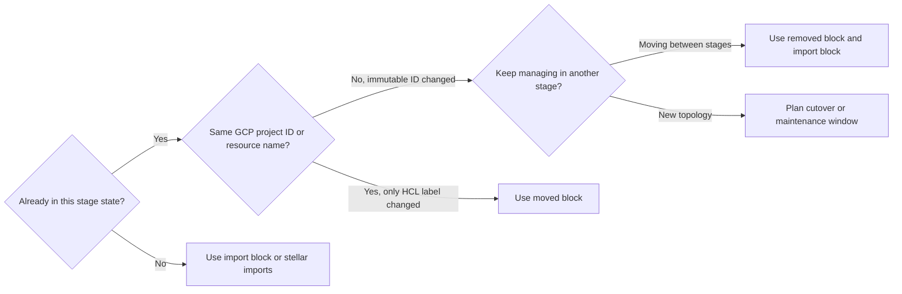

# Upgrade deployments

Upgrade existing Stellar Engine landing zone stages and blueprints without destroying live Google Cloud resources by reconciling Terraform state before any API call runs. Stellar Engine targets Assured Workloads environments where Cloud KMS keyrings, Assured Workloads folders, organization logging sinks, and Shared VPC host projects resist deletion or require scheduled change windows. Declarative `moved`, `import`, and `removed` configuration blocks let you preview every state transition during `terraform plan`.

<!-- BEGIN TOC -->
- [1. Choose the block](#1-choose-the-block)
- [2. Run stage upgrades](#2-run-stage-upgrades)
  - [2.1 Check release boundaries](#21-check-release-boundaries)
  - [2.2 Apply migration files](#22-apply-migration-files)
- [3. Adopt brownfield resources](#3-adopt-brownfield-resources)
  - [3.1 Use Stellar CLI](#31-use-stellar-cli)
  - [3.2 Write import blocks](#32-write-import-blocks)
- [4. Move across stages](#4-move-across-stages)
- [5. Release upgrade paths](#5-release-upgrade-paths)
  - [5.1 Upgrade to v5.0](#51-upgrade-to-v50)
    - [Reconcile resource labels](#reconcile-resource-labels)
    - [Update Gemini Enterprise](#update-gemini-enterprise)
    - [Migrate Cloud Run](#migrate-cloud-run)
  - [5.2 Upgrade to v5.2](#52-upgrade-to-v52)
    - [Reconcile organization toggles](#reconcile-organization-toggles)
    - [Reconcile OS Login](#reconcile-os-login)
    - [Protect imported projects](#protect-imported-projects)
  - [5.3 Upgrade to v6.0](#53-upgrade-to-v60)
    - [Review state impact](#review-state-impact)
    - [Update Stage 2a inputs](#update-stage-2a-inputs)
    - [Execute network cutover](#execute-network-cutover)
- [6. Avoid upgrade pitfalls](#6-avoid-upgrade-pitfalls)
<!-- END TOC -->

## 1. Choose the block

Select the Terraform configuration block that matches whether the Google Cloud resource already exists in your current stage state and whether its immutable cloud identifier stays the same.



| Upgrade scenario | Block to declare | Expected `terraform plan` summary |
| --- | --- | --- |
| Terraform resource or module label changed on the same Google Cloud resource | `moved` | `# <old> has moved to <new>` and `0 to destroy` |
| Existing Google Cloud resource is not yet tracked in this stage state | `import` | `X to import, 0 to destroy` |
| Live Google Cloud resource moves from one stage to another | `removed` in source stage and `import` in target stage | Source stage drops management without deleting; target stage imports |
| Immutable Google Cloud project ID, bucket name, or VPC topology changed | None | Replacement planned; schedule a cutover or maintenance window |

Prefer declarative HCL blocks over imperative `terraform state mv`, `terraform import`, and `terraform state rm` CLI commands. Imperative state commands mutate your remote Cloud Storage state file immediately without a dry run, whereas declarative blocks take effect only after you inspect and approve `terraform plan`.

## 2. Run stage upgrades

Advance deployments across release boundaries in stage order from `0-bootstrap` and `1-resman` through `2-networking-*`, `3-security`, and workload blueprints so downstream stages receive refreshed `.auto.tfvars.json` outputs.

### 2.1 Check release boundaries

Review [CHANGELOG.md](../CHANGELOG.md) for every release between your deployed Git tag and your target Git tag before running Terraform.

- Minor and patch releases within the same major series retain built-in `moved` blocks inside stage, module, and blueprint `.tf` files so `terraform plan` updates state addresses automatically.
- Major releases may retire older `moved` blocks or introduce breaking variable, output, or topology changes documented under `Breaking Changes` with an `upgrade-note` block.
- Apply the latest minor release of your current major version before checking out the next major version so your remote state records all intermediate address migrations.
- Confirm that object versioning is enabled on your automation state buckets such as `<prefix>-prod-iac-core-bootstrap-0`, `<prefix>-prod-iac-core-resman-0`, and stage branch buckets so prior state versions remain recoverable.

### 2.2 Apply migration files

Place temporary `moved`, `import`, or `removed` blocks from release `upgrade-note` instructions into a dedicated `migrations.tf` file inside your active stage workspace rather than editing tracked `.tf` files.

```hcl
# migrations.tf
moved {
  from = module.organization-logging
  to   = module.organization-logging[0]
}
```

Run the following sequence in each stage workspace:

1. Refresh stage provider and `.auto.tfvars.json` links with `fast/stage-links.sh` or `stellar render`.
2. Run `terraform init` and `terraform plan -out=upgrade.tfplan` using the stage automation service account configured in `<stage>-providers.tf`.
3. Inspect the saved plan and confirm `0 to destroy` on stateful resources such as projects, folders, Cloud KMS keys, VPC networks, and Cloud Logging buckets.
4. Check for `# <old> has moved to <new>` lines in the plan output, which confirm that Terraform matched your existing state entry to the renamed HCL address.
5. Run `terraform apply upgrade.tfplan` to write the updated state addresses to Cloud Storage.
6. Remove any temporary `migrations.tf` file that you created yourself while leaving built-in repository `moved` blocks untouched, and run `terraform plan` once more to confirm `No changes. Your infrastructure matches the configuration.`

## 3. Adopt brownfield resources

Import pre-created Google Cloud projects, Assured Workloads workloads, organization policies, and brownfield networks into Terraform state before applying stage configurations.

### 3.1 Use Stellar CLI

Use the [Stellar CLI](../cli/README.md) whenever you manage `0-bootstrap` and `1-resman` through an `answers.yaml` environment file instead of writing manual import scripts.

```yaml
# answers.yaml
keep_imported_projects: true
imports:
  0-bootstrap:
    module.automation-project.google_project.project[0]: acme-prod-iac-core-0
    module.log-export-project.google_project.project[0]: acme-prod-audit-logs-0
    google_assured_workloads_workload.primary[0]: organizations/123456789012/locations/us-east4/workloads/abc123
```

- List pre-created Stage 0 projects or an existing Assured Workloads workload under the `imports.0-bootstrap` map in `answers.yaml` when billing account linkage requires an administrator to create them ahead of Terraform.
- Keep the `keep_imported_projects` answer set to `true` so `stellar render` writes `ABANDON` to `var.project_deletion_policies` for each imported project and protects them during `terraform destroy`.
- Run `stellar imports scan` to record organization policies already enforced on your Google Cloud organization under `existing_org_policies` in `answers.yaml`, replacing the legacy `0-bootstrap/import.sh` script.
- Run `stellar render --stage 0` to write `0-bootstrap-imports.tf` in your environment workspace, keeping generated `import` blocks separate from engine source files.

### 3.2 Write import blocks

Create a temporary `imports.tf` file in the stage workspace when adopting brownfield resources in `2-networking-a-fedramp`, `2-networking-b-il5-ngfw`, `3-security`, or workload blueprints.

```hcl
# imports.tf
import {
  id = "projects/acme-net-hub-host"
  to = module.hub-project.google_project.project[0]
}

import {
  id = "projects/acme-net-hub-host/global/networks/hub-0"
  to = module.hub-vpc.google_compute_network.network[0]
}
```

Run `terraform plan` before applying any `import` block and inspect every attribute diff on the imported resource. Importing brings the live Google Cloud state into Terraform, and any mismatch between live settings and your `terraform.tfvars` values causes Terraform to modify or replace the resource during `terraform apply`.

## 4. Move across stages

Transfer management of a live Google Cloud resource from one stage state to another without deleting it by pairing a `removed` block in the source stage with an `import` block in the destination stage. Check `versions.tf` in each stage directory for the required Terraform version constraint.

1. Remove the resource declaration from the source stage configuration and add a `removed` block with `destroy = false`:

```hcl
# Source stage: migrations.tf
removed {
  from = google_logging_folder_settings.root

  lifecycle {
    destroy = false
  }
}
```

2. Run `terraform plan` in the source stage and confirm the plan states `# google_logging_folder_settings.root will no longer be managed by Terraform, but will not be destroyed`, then run `terraform apply`.
3. Add an `import` block in the destination stage targeting the Google Cloud resource identifier:

```hcl
# Destination stage: imports.tf
import {
  id = "folders/123456789012/settings"
  to = module.organization-logging[0].google_logging_organization_settings.default[0]
}
```

4. Run `terraform plan` in the destination stage, confirm `1 to import, 0 to add, 0 to change, 0 to destroy`, run `terraform apply`, and delete both temporary migration files.

## 5. Release upgrade paths

Use the version-specific sections below alongside [CHANGELOG.md](../CHANGELOG.md) when upgrading existing deployments from `v4.x` through `v5.x` and `v6.0`.

| Upgrade path | Affected components | State mechanism | Operator action |
| --- | --- | --- | --- |
| `v4.x` to `v5.0.0` | All FAST stages, `blueprints/`, custom `modules/cloud-run` callers | Built-in `moved` blocks; `removed` and `import` for Cloud Run v2 | Update `gemini-enterprise` path and regimes; migrate custom Cloud Run v1 callers |
| `v5.0.0` to `v5.2.0` | `0-bootstrap`, `1-resman`, `stellar` CLI | Built-in `moved` blocks; optional `import` and `removed` blocks | Re-apply `0-bootstrap` then `1-resman`; add `removed` if turning off org-level toggles on live orgs |
| `v5.2.0` to `v6.0.0` on `main` | `2-networking-a-fedramp`, downstream Stage 3 and blueprints | Spoke preservation with Hub and NCC cutover | Update Stage 2a `terraform.tfvars` from VDSS and NVA inputs to Hub, NCC, and firewall policy inputs |

### 5.1 Upgrade to v5.0

Release `v5.0.0` standardizes Terraform naming conventions across the repository and removes legacy Cloud Run v1 and Gemini Enterprise paths introduced in `v4.x`.

#### Reconcile resource labels

All FAST stages and blueprints rename Terraform resource labels to `snake_case` and module labels to `kebab-case` to satisfy `.tflint.hcl`. Built-in `moved` blocks ship directly inside the stage and blueprint `.tf` files:

```hcl
# Built into fast/stages-aw/0-bootstrap/automation.tf
moved {
  from = google_compute_project_metadata.metadata-automation
  to   = google_compute_project_metadata.metadata_automation
}
```

- Run `terraform init -upgrade` and `terraform plan` in each deployed stage and blueprint before upgrading past `v5.x` so your state file records the new addresses while the built-in `moved` blocks remain present.
- Verify that the plan shows only `# ... has moved to ...` notices and `0 to destroy` for existing infrastructure.

#### Update Gemini Enterprise

Deployments upgrading from `v4.0.x` or `v4.1.x` pick up the `v4.2.0` relocation of the Gemini Enterprise blueprint from `blueprints/fedramp-high/gemini-enterprise` to `blueprints/gemini-enterprise`.

- Point CI/CD pipelines and working directories to `blueprints/gemini-enterprise/gemini-stage-0` and `blueprints/gemini-enterprise/gemini-stage-1`.
- Replace deprecated `US_REGIMES` or `EXPERIMENTAL` values on `var.compliance_regime` in `terraform.tfvars` with `FEDRAMP_MODERATE`, `FEDRAMP_HIGH`, `IL4`, `IL5`, or `NONE`.
- Remove any unused `auto_delete` variable assignment from `blueprints/fedramp-high/bigtable/terraform.tfvars`.

#### Migrate Cloud Run

Release `v5.0.0` removes the unreferenced `modules/cloud-run` v1 module in favor of `modules/cloud-run-v2` and `modules/cloud-run-v2-se`. Because the Google Cloud provider models `google_cloud_run_service` and `google_cloud_run_v2_service` as distinct Terraform resource types, a `moved` block cannot convert between them. Because both APIs view the same underlying Cloud Run service in Google Cloud, any custom caller of `modules/cloud-run` can adopt the service in place with a `removed` block and an `import` block:

```hcl
# migrations.tf in custom Cloud Run caller
removed {
  from = module.app-v1.google_cloud_run_service.service[0]

  lifecycle {
    destroy = false
  }
}

import {
  id = "projects/acme-app-0/locations/us-east4/services/my-service"
  to = module.app.google_cloud_run_v2_service.service[0]
}
```

### 5.2 Upgrade to v5.2

Releases `v5.1.0`, `v5.1.1`, and `v5.2.0` add brownfield project and workload adoption, folder logging inheritance, granular organization-resource toggles in `0-bootstrap`, and the `stellar` workspace renderer.

#### Reconcile organization toggles

Release `v5.2.0` adds the `var.deploy_org_resources` object with `audit_config`, `custom_roles`, `iam`, `logging_settings`, `logging_sinks`, `org_policies`, and `workforce_identity_pool` flags, all defaulting to `true`. Built-in `moved` blocks in `audit-logging.tf` and `organization.tf` migrate singletons to `[0]`-indexed addresses automatically:

```hcl
# Built into fast/stages-aw/0-bootstrap/organization.tf
moved {
  from = module.organization-logging
  to   = module.organization-logging[0]
}
```

- Run `terraform init` and `terraform apply` in `0-bootstrap` with the default `deploy_org_resources` settings to record the `[0]` state moves with zero resource changes.
- Pair any subsequent change that sets a `var.deploy_org_resources` flag to `false` on an existing deployment with a `removed` block so Terraform drops management without deleting live organization resources:

```hcl
# migrations.tf in fast/stages-aw/0-bootstrap
removed {
  from = google_organization_iam_audit_config.organization[0]

  lifecycle {
    destroy = false
  }
}
```

#### Reconcile OS Login

Release `v5.2.0` moves `compute.requireOsLogin` into the regime-aware `data/custom-org-policies/compute_policy.yaml` template so Stage 0 enforces it on `FEDRAMP_MODERATE` and `FEDRAMP_HIGH` while skipping it on `IL4` and `IL5`, where Assured Workloads manages OS Login at the folder level.

- On existing `IL4` or `IL5` deployments, `terraform plan` in `0-bootstrap` plans to destroy `module.organization.google_org_policy_policy.default["compute.requireOsLogin"]`.
- Allow the destroy if Stage 0 originally created that organization-level policy and you want the Assured Workloads folder policy to govern alone, or declare a `removed` block with `destroy = false` in `migrations.tf` if an external team owns the organization-level policy and you only want Stage 0 to drop state management.

#### Protect imported projects

Set `var.project_deletion_policies` in `0-bootstrap/terraform.tfvars` whenever an earlier deployment imported pre-created `automation`, `billing`, or `logging` projects manually so `terraform destroy` leaves those projects intact:

```hcl
project_deletion_policies = {
  automation = "ABANDON"
  billing    = "ABANDON"
  logging    = "ABANDON"
}
```

### 5.3 Upgrade to v6.0

Upcoming `v6.0.0` on `main` modernizes `fast/stages-aw/2-networking-a-fedramp` by replacing the legacy Virtual Data Security Stack and Linux Network Virtual Appliance topology with a central Hub VPC `<prefix>-net-hub-host` and `hub-0`, a `STAR`-topology Network Connectivity Center hub, `BEFORE_CLASSIC_FIREWALL` global network firewall policies, Private Service Connect endpoints for Google APIs, and optional Secure Web Proxy centralized internet egress. Stage `2-networking-b-il5-ngfw` is unchanged.

#### Review state impact

- Environment spoke host projects in `module.env-spoke-projects` and spoke VPCs in `module.env-spoke-vpc` retain their Terraform addresses and Google Cloud project and VPC names, so workload subnets and attached Shared VPC service projects stay intact.
- Legacy VDSS resources including `module.vdss-host-project`, `module.vdss-vpc`, `module.dmz-vpc`, NVA managed instance groups, and full-mesh `module.peering-*` links are replaced by `module.hub-project`, `module.hub-vpc`, `module.hub-nat`, `module.hub-firewall-policy`, `google_network_connectivity_hub.hubs["main"]`, and `google_network_connectivity_spoke.vpcs`.
- Do not write `moved` blocks from `module.vdss-host-project` to `module.hub-project` or from `module.vdss-vpc` to `module.hub-vpc`, because the project ID changed from `net-vdss-host` to `net-hub-host` and the VPC name changed from `vdss-landing-0` to `hub-0`, causing Terraform to plan a replacement regardless.

#### Update Stage 2a inputs

Update `fast/stages-aw/2-networking-a-fedramp/terraform.tfvars` to match the new interface before running `terraform init`:

| Legacy `v5.2.0` input or output | `v6.0.0` replacement | Migration action |
| --- | --- | --- |
| `var.nva_spot_vms` and `var.dns.resolvers` | Removed | Delete both settings from `terraform.tfvars`. |
| `var.subnets.landing` and `var.subnets.dmz` | `var.subnets.hub` | Move central hub subnets under the `hub` key and drop `dmz` subnets. |
| `secondary_ip_ranges = { pods = "10.x.x.x/16" }` | `secondary_ip_ranges = { pods = { ip_cidr_range = "10.x.x.x/16" } }` | Wrap each secondary CIDR string in an object supporting `ip_cidr_range` or `reserved_internal_range`. |
| `var.firewall_rules` | `var.firewall_policy_rules` | Translate classic VPC rules to prioritized Cloud NGFW `match = { layer4_configs = [...] }` entries keyed by `hub`, `egress`, or spoke name. |
| `output.vdss` and `host_project_numbers["prod-landing"]` | `output.hub`, `output.ncc_hubs`, `output.ncc_spokes`, `output.psc_google_apis_endpoints`, and `host_project_numbers["hub"]` | Rerun `fast/stage-links.sh` after applying Stage 2a so `2-networking.auto.tfvars.json` updates before running `3-security` or blueprints. |

#### Execute network cutover

Choose between an in-place hub cutover or a detached VDSS retention path depending on whether workloads currently route egress or hybrid traffic through the legacy VDSS project:

1. For deployments with no active hybrid links on `net-vdss-host`, schedule a maintenance window for east-west spoke transit, update `2-networking-a-fedramp/terraform.tfvars`, run `terraform init -upgrade` and `terraform plan -out=s2.tfplan`, confirm `module.env-spoke-projects` and `module.env-spoke-vpc` are not destroyed, apply `s2.tfplan`, and refresh `2-networking.auto.tfvars.json` for `3-security`.
2. If you must keep the legacy `<prefix>-net-vdss-host` project alive temporarily while migrating custom routes or hybrid VPNs onto `ncc_hubs`, detach the legacy project and VPCs from Stage 2a state first using `removed` blocks with `destroy = false` in `migrations.tf`, apply Stage 2a to stand up `<prefix>-net-hub-host` and NCC alongside it, and decommission the detached VDSS project after traffic cutover completes:

```hcl
# Optional migrations.tf in 2-networking-a-fedramp to preserve legacy VDSS project during cutover
removed {
  from = module.vdss-host-project

  lifecycle {
    destroy = false
  }
}

removed {
  from = module.vdss-vpc

  lifecycle {
    destroy = false
  }
}
```

## 6. Avoid upgrade pitfalls

Watch for three Google Cloud and Terraform behaviors that can trigger unexpected replacements or permission errors during an upgrade.

- Inspect plans for `forces replacement` notices right after adding an `import` block, because some Google Cloud APIs omit creation-only fields such as `billing_account` and `resource_settings` on `google_assured_workloads_workload` when reading resources back. Confirm that your stage code includes the `v5.1.0` `lifecycle { ignore_changes = [billing_account, resource_settings] }` rule before running `terraform apply`.
- Avoid declaring `moved` blocks when a stage changes an immutable Google Cloud attribute such as a project ID, Cloud Storage bucket name, or VPC network name. A `moved` block rebinds the Terraform state address, after which the provider still plans a destroy-and-recreate because the cloud identifier changed.
- Unset `GOOGLE_IMPERSONATE_SERVICE_ACCOUNT` and `CLOUDSDK_AUTH_IMPERSONATE_SERVICE_ACCOUNT` in your shell and run `fast/stage-links.sh` before planning each stage, because running Stage 2 or Stage 3 with leftover Stage 0 bootstrap credentials produces misleading `403` state or API errors.
