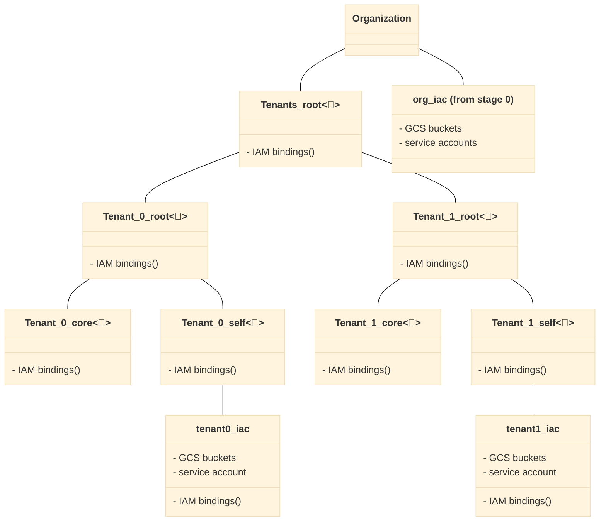

# Resource hierarchy

Stage 1 provisions environment folders (`Int`, `Test`, and `Prod`), tenant projects, and the `Networking` and `Security` folders consumed by downstream stages. Unlike upstream Cloud Foundation Fabric, every folder and project resides beneath the Stage 0 Assured Workloads folder to keep all workloads and audit logs inside the compliance boundary.

<!-- BEGIN TOC -->
- [1 Design overview](#1-design-overview)
- [2 Stage deployment](#2-stage-deployment)
  - [Service account impersonation](#service-account-impersonation)
  - [Lightweight multitenancy](#lightweight-multitenancy)
  - [Team folders](#team-folders)
  - [IAM bindings](#iam-bindings)
  - [Additional folders](#additional-folders)
- [Variables](#variables)
- [Outputs](#outputs)
<!-- END TOC -->

## 1 Design overview

Placing the entire resource hierarchy inside the Assured Workloads folder ensures every tenant project, host network, and log sink inherits regional data residency and compliance guardrails automatically.

## 2 Stage deployment

Follow the [Detailed Deployment Guide](/docs/ddg.md) for prerequisites and step-by-step deployment commands.

### Service account impersonation

The generated provider configuration impersonates the Stage 1 automation service account. Ensure your active user identity belongs to `gcp-devops` or `organization-admins`, both of which receive impersonation permissions in Stage 0.

### Lightweight multitenancy

When your organization requires tenant isolation without separate per-tenant FAST pipelines, define lightweight tenants in the `tenants` variable and shared tenant IAM settings in the `tenants_config` variable.

This configuration creates a `Tenants` folder branch containing one folder per tenant, split into centrally managed `core` folders and tenant-managed folders with dedicated automation buckets and service accounts. Downstream stages can provision centralized networking for each tenant while tenant administrators manage their own application projects.

Stage 1 binds default IAM roles across three folder levels for each tenant:

- Top-level tenant folder bindings for the core IaC service account:
  - `roles/cloudasset.owner`
  - `roles/compute.xpnAdmin`
  - `roles/logging.admin`
  - `roles/resourcemanager.folderAdmin`
  - `roles/resourcemanager.projectCreator`
  - `roles/resourcemanager.tagUser`
- Centrally managed `core` folder bindings:
  - `roles/owner` for the core IaC service account
  - `roles/viewer` for the tenant admin group and tenant IaC service account
- Tenant-managed folder bindings for the tenant admin group and tenant IaC service account:
  - `roles/cloudasset.owner`
  - `roles/compute.xpnAdmin`
  - `roles/logging.admin`
  - `roles/resourcemanager.folderAdmin`
  - `roles/resourcemanager.projectCreator`
  - `roles/resourcemanager.tagUser`
  - `roles/owner`

Customize these role grants through the `tenants_config` variable.



Replace the tenant keys and descriptions in `terraform.tfvars` with your tenant identifiers:

```tfvars
tenants = {
{{EDIT_THIS_VARIABLE_TO_THE_FIRST_TENANT_NAME}} = {
  admin_principal  = "group:gcp-devops@example.com"
  descriptive_name = "{{EDIT_THIS_VARIABLE_TO_THE_FIRST_TENANT_DESCRIPTION}}"
  locations = {
    gcs = "us-east4"
    kms = "us-east4" # Must match GCS Region
   }
 },
  {{EDIT_THIS_VARIABLE_TO_THE_SECOND_TENANT_NAME}} = {
   admin_principal  = "group:gcp-devops@example.com"
   descriptive_name = "{{EDIT_THIS_VARIABLE_TO_THE_SECOND_TENANT_DESCRIPTION}}"
   locations = {
     gcs = "us-west1"
     kms = "us-west1" # Must match GCS Region
  }
 }
}
```

The following example configures two tenants named `wingarch` and `fuselagerd`, generating dedicated provider and `.tfvars` files for each tenant:

```tfvars
tenants = {
wingarch = {
  admin_principal  = "group:gcp-devops@example.com"
  descriptive_name = "Wing Architect Research Group"
  locations = {
    gcs = "us-east4"
    kms = "us-east4" # Must match GCS Region
   }
 },
  fuselagerd = {
   admin_principal  = "group:gcp-devops@example.com"
   descriptive_name = "Fuselage Research & Development Group"
   locations = {
     gcs = "us-west1"
     kms = "us-west1" # Must match GCS Region
  }
 }
}
```

### Team folders

Set the `team_folders` variable to group workloads by application or business unit under a `Teams` folder branch with dedicated automation service accounts and IAM bindings:

```tfvars
team_folders = {
  wingarch = {
    descriptive_name = "Wing Architect Research Group"
    iam_by_principals = {
      "group:team-a@example.com" = [
        "roles/viewer"
      ]
    }
    impersonation_principals = ["group:team-a-admins@example.com"]
  }
  fuselagerd = {
    descriptive_name = "Fuselage Research & Development Group"
    iam_by_principals = {
      "group:team-b@example.com" = [
        "roles/viewer"
      ]
    }
  }
}
```

Applying this configuration provisions the team resources required to delegate folder management to a CI/CD pipeline or team administrator group:

- Team folders (`wingarch` and `fuselagerd`) under the `Teams` folder with `roles/viewer` bound to each team's configured group.
- CMEK-encrypted Cloud Storage state buckets in the automation project that satisfy IL5 encryption requirements.
- Per-team automation service accounts in the automation project with folder and bucket IAM bindings and group impersonation policies.
- Default Cloud KMS keys for tenant projects.

### IAM bindings

Use the `folder_iam` variable to manage authoritative IAM bindings on top-level folders. For finer-grained adjustments, edit the `iam`, `iam_bindings`, and `iam_bindings_additive` module inputs in the corresponding `branch-*.tf` file following the human-versus-machine principal pattern documented in the [Stage 0 customizations](../0-bootstrap/README.md#3-customizations) section.

See [IAM.md](./IAM.md) for the full list of IAM roles managed by this stage.

### Additional folders

Clone an existing `branch-*.tf` file and update its module names and folder identifiers to add a new top-level hierarchy branch, such as shared GKE clusters.

<!-- BEGIN TFDOC -->
## Variables

| name | description | type | required | default |
|---|---|:---:|:---:|:---:|
| [alert_email](variables.tf#L19) | Email to receive log alerts. | <code>string</code> | ✓ |  |
| [automation](variables.tf#L35) | Automation resources created by the bootstrap stage. | <code>object&#40;&#123;&#8230;&#125;&#41;</code> | ✓ |  |
| [billing_account](variables.tf#L61) | Billing account id. If billing account is not part of the same org set `is_org_level` to `false`. To disable handling of billing IAM roles set `no_iam` to `true`. | <code>object&#40;&#123;&#8230;&#125;&#41;</code> | ✓ |  |
| [common_services_folder](variables.tf#L175) | Common services folder where non-tenant related resources should be kept. | <code>string</code> | ✓ |  |
| [envs_folders](variables.tf#L208) | List of environments to be created for projects to go into. | <code>map&#40;object&#40;&#123;&#8230;&#125;&#41;&#41;</code> | ✓ |  |
| [organization](variables.tf#L287) | Organization details. | <code>object&#40;&#123;&#8230;&#125;&#41;</code> | ✓ |  |
| [prefix](variables.tf#L303) | Prefix used for resources that need unique names. Use 7 characters or less. | <code>string</code> | ✓ |  |
| [regime_mapping](variables.tf#L314) | Mapping of compliance regime names to short codes. | <code>map&#40;string&#41;</code> | ✓ |  |
| [regions](variables.tf#L319) | Region definitions. Inherited from 0-bootstrap outputs. Must be specified in bootstrap terraform.tfvars. | <code>object&#40;&#123;&#8230;&#125;&#41;</code> | ✓ |  |
| [assured_workloads](variables.tf#L24) | Configuration for Assured Workloads. | <code>object&#40;&#123;&#8230;&#125;&#41;</code> |  | <code>&#123;&#125;</code> |
| [billing_override](variables.tf#L72) | Optional billing override configuration. If set, disables service account impersonation for project billing linkage and runs under the user account using the specified quota projects. | <code>object&#40;&#123;&#8230;&#125;&#41;</code> |  | <code>null</code> |
| [cicd_repositories](variables.tf#L81) | CI/CD repository configuration. Identity providers reference keys in the `automation.federated_identity_providers` variable. Set to null to disable, or set individual repositories to null if not needed. | <code>object&#40;&#123;&#8230;&#125;&#41;</code> |  | <code>null</code> |
| [custom_roles](variables.tf#L180) | Custom roles defined at the org level, in key => id format. | <code>object&#40;&#123;&#8230;&#125;&#41;</code> |  | <code>null</code> |
| [deploy_org_resources](variables.tf#L192) | Granular control over the deployment of organization-level resources. | <code>object&#40;&#123;&#8230;&#125;&#41;</code> |  | <code>&#123;&#125;</code> |
| [factories_config](variables.tf#L215) | Configuration for the resource factories or external data. | <code>object&#40;&#123;&#8230;&#125;&#41;</code> |  | <code>&#123;&#125;</code> |
| [fast_features](variables.tf#L225) | Selective control for top-level FAST features. | <code>object&#40;&#123;&#8230;&#125;&#41;</code> |  | <code>&#123;&#125;</code> |
| [folder_iam](variables.tf#L241) | Authoritative IAM for top-level folders. | <code>object&#40;&#123;&#8230;&#125;&#41;</code> |  | <code>&#123;&#125;</code> |
| [force_destroy](variables.tf#L258) | Toggles force_destroy for GCS buckets. | <code>bool</code> |  | <code>false</code> |
| [groups](variables.tf#L264) | Group names or IAM-format principals to grant organization-level permissions. If just the name is provided, the 'group:' principal and organization domain are interpolated. | <code>object&#40;&#123;&#8230;&#125;&#41;</code> |  | <code>&#123;&#125;</code> |
| [kms_protection_level](variables.tf#L279) | KMS protection level. | <code>string</code> |  | <code>null</code> |
| [outputs_location](variables.tf#L297) | Enable writing provider, tfvars and CI/CD workflow files to local filesystem. Leave null to disable. | <code>string</code> |  | <code>null</code> |
| [team_folders](variables.tf#L328) | Team folders to be created. Format is described in a code comment. | <code>map&#40;object&#40;&#123;&#8230;&#125;&#41;&#41;</code> |  | <code>null</code> |
| [tenants](variables.tf#L344) | Lightweight tenant definitions. | <code>map&#40;object&#40;&#123;&#8230;&#125;&#41;&#41;</code> |  | <code>&#123;&#125;</code> |
| [tenants_config](variables.tf#L373) | Lightweight tenants shared configuration. Roles will be assigned to tenant admin group and service accounts. | <code>object&#40;&#123;&#8230;&#125;&#41;</code> |  | <code>&#123;&#125;</code> |

## Outputs

| name | description | sensitive |
|---|---|:---:|
| [cicd_repositories](outputs.tf#L396) | WIF configuration for CI/CD repositories. |  |
| [dataplatform](outputs.tf#L410) | Data for the Data Platform stage. |  |
| [envs](outputs.tf#L426) | Environments folders created for the tenants. |  |
| [gcve](outputs.tf#L431) | Data for the GCVE stage. |  |
| [gke_multitenant](outputs.tf#L452) | Data for the GKE multitenant stage. |  |
| [networking](outputs.tf#L473) | Data for the networking stage. |  |
| [project_factories](outputs.tf#L482) | Data for the project factories stage. |  |
| [providers](outputs.tf#L497) | Terraform provider files for this stage and dependent stages. | ✓ |
| [sandbox](outputs.tf#L504) | Data for the sandbox stage. |  |
| [security](outputs.tf#L518) | Data for the networking stage. |  |
| [team_cicd_repositories](outputs.tf#L528) | WIF configuration for Team CI/CD repositories. |  |
| [teams](outputs.tf#L542) | Data for the teams stage. |  |
| [tfvars](outputs.tf#L554) | Terraform variable files for the following stages. | ✓ |
<!-- END TFDOC -->
