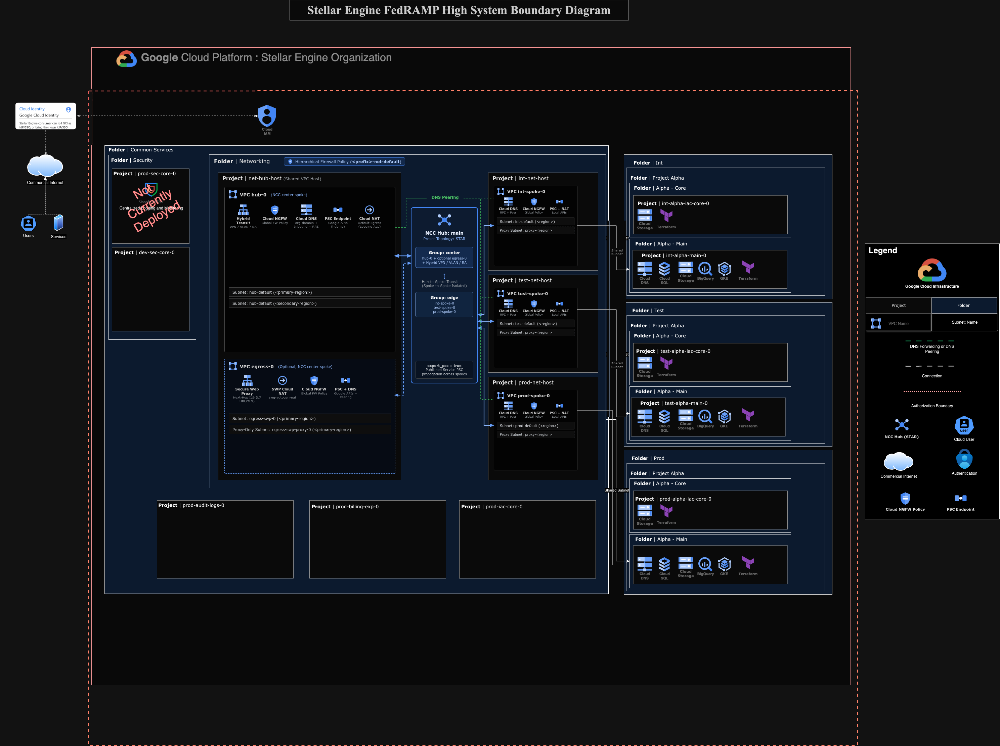

# FedRAMP High and Moderate Network

This stage deploys a hub-and-spoke network topology built on Network Connectivity Center for Assured Workloads environments targeting FedRAMP High, FedRAMP Moderate, and DoD Impact Level 2, including `IL2`.

## 1 Topology and regime coverage

Stage 2 provisions a central hub Shared VPC (`hub-0`) inside `<prefix>-net-hub-host` and connects environment spoke Shared VPCs (`<env>-spoke-0`) through a default `STAR` Network Connectivity Center hub (`main`).

- Placing `hub-0` in the `center` group and all environment spoke VPCs in the `edge` group enforces network segmentation across environments while allowing centralized DNS and hybrid transit through the hub project for NIST SP 800-53r5 SC-7 and AC-4 controls.
- Each environment spoke VPC includes a regional proxy-only subnet (`proxy_subnets`) so tenant projects can deploy regional Application Load Balancers with Cloud Armor WAF policies directly in spoke networks.
- Although the Stage 0 `FEDRAMP_MODERATE` organization policy template only denies `in:asia-east2-locations` and `in:global`, this networking stage is validated and supported for US regions (`in:us-locations`, such as `us-east4`, `us-west1`, and `us-central1`).
- Replace every `<region>` placeholder in the sample `terraform.tfvars` file with the `regions.primary` value from Stage 0, because the stage validates that the first tenant subnet of each environment uses that region.
- `IL2` workloads land on `2-networking-a-fedramp`, whereas `IL4` and `IL5` workloads use `2-networking-b-il5-ngfw` with Palo Alto VM-Series Next-Generation Firewalls in a three-VPC VDSS layout.

## 2 Firewall policy governance

Stage 2 combines a folder-level hierarchical firewall policy (`module.firewall-policy-default`) on the `Networking` folder with per-VPC global network firewall policies (`module.hub-firewall-policy`, `module.env-spoke-firewall-policy`, and `module.egress-firewall-policy`) attached to `hub-0`, each `<env>-spoke-0` VPC, and the optional `egress-0` VPC.

- Every Stage 2 VPC sets `firewall_policy_enforcement_order = "BEFORE_CLASSIC_FIREWALL"` so global network firewall policies evaluate after the folder hierarchical firewall policy and before any blueprint-local classic VPC firewall rules (`google_compute_firewall`) created by workload blueprints such as `blueprints/fedramp-high/bastion-pattern`.
- Configure per-VPC ingress, egress, and packet-mirroring rules inline through `firewall_policy_rules` or declaratively through YAML files under `data/firewall-policies/<vpc>-ingress.yaml`, `<vpc>-egress.yaml`, `<vpc>-ingress-mirroring.yaml`, and `<vpc>-egress-mirroring.yaml`, using `$cidr_ranges_sets:`, `$cidr_ranges:`, and `$security_profile_groups:` context references.
- Global network firewall policy rules support Cloud NGFW Essentials Layer 4 controls and IAM secure tags, Cloud NGFW Standard `fqdns`, `region_codes`, and `threat_intelligences` matchers, and Cloud NGFW Enterprise Layer 7 inspection (`action = "apply_security_profile_group"` with `security_profile_group_ids` and `tls_inspect`) plus out-of-band packet mirroring (`ingress_mirroring` and `egress_mirroring`).
- When collecting CM-6 and SC-7 firewall evidence, inspect the folder hierarchical firewall policy (`gcloud compute firewall-policies rules list --firewall-policy=<policy-id> --organization=<org-id>`), each host-project global network firewall policy (`gcloud compute network-firewall-policies rules list --firewall-policy=<name> --global --project=<network-project-id>`), and any blueprint classic VPC firewall rules (`gcloud compute firewall-rules list --project=<network-project-id>`).

## 3 Private Google APIs access

When `psc_google_apis.enabled` is `true`, which is the default, the stage provisions a dedicated Private Service Connect endpoint (`modules/net-address`) targeting `all-apis` or `vpc-sc` inside `hub-0`, each `<env>-spoke-0` VPC, and the optional `egress-0` VPC.

- Private Service Connect endpoints for Google APIs are not transitive across Network Connectivity Center, so each spoke VPC receives its own internal endpoint IP (`10.255.255.10` and above by default), Service Directory-backed `p.googleapis.com.` private DNS zone (`goog-psc-*`), and `googleapis` Cloud DNS response policy (`private.googleapis.com.` and `restricted.googleapis.com.`) while peering `${organization.domain}.` to `hub-0`.
- Inbound DNS forwarding on `hub-0` resolves Google API domains to `psc_google_apis.hub_ip` (`10.255.255.1` by default) so on-premises networks connected through Cloud VPN or Cloud Interconnect can reach Google APIs privately when Cloud Router advertises that `/32` address.
- Setting `export_psc = true` on the `main` Network Connectivity Center hub propagates Private Service Connect endpoints for published producer services across spoke VPCs without requiring Private Services Access VPC peering; configure `psa_ranges` only for legacy services that do not use Private Service Connect.
- Set `psc_google_apis.enabled = false` only if you require legacy `199.36.153.8/30` and `199.36.153.4/30` Private Google Access routes and root `.` DNS peering to `hub-0`.

## 4 Centralized internet egress

Outbound internet egress defaults to distributed per-VPC Cloud NAT gateways (`enable_cloud_nat = true`, `centralized_egress.enabled = false`) because Network Connectivity Center VPC spokes exchange subnet routes only and do not transit `0.0.0.0/0` default routes.

- Set `centralized_egress.enabled = true` to deploy a dedicated `egress-0` VPC spoke in the `main` hub `center` group running Secure Web Proxy (`modules/net-swp`) in `NEXT_HOP_ROUTING_MODE`, which automatically provisions its managed `swg-autogen-nat` Cloud NAT gateway.
- Enabling `centralized_egress` replaces per-VPC Cloud NAT on `hub-0` and `<env>-spoke-0` with untagged static `0.0.0.0/0` `next_hop_ilb` routes pointing to `centralized_egress.swp_ip` so outbound HTTP and HTTPS traffic traverses centralized URL lists and Layer 7 proxy rules.
- Define Secure Web Proxy URL lists, policy rules, and optional TLS inspection (`centralized_egress.tls_inspection_config`) inline or in YAML files under `data/swp-url-lists/` and `data/swp-policy-rules/`.

## 5 NCC hub factory

When `enable_default_ncc_hub` is `true`, which is the default, the stage provisions the `main` `STAR` hub inside `<prefix>-net-hub-host` with `center` and `edge` groups and attaches `hub-0`, optional `egress-0`, and every `<env>-spoke-0` VPC automatically. You can extend the `main` hub to attach Cloud VPN tunnels, Cloud Interconnect VLAN attachments, or router appliance spokes, or define additional hubs through YAML files under `data/ncc-hubs/` (`factories_config.ncc_hubs`) and through the `ncc_hubs` variable.

- Symbolic `$project_ids:<key>` references resolve Stage 2 host projects (`hub`, `hub-host`, `net-hub-host`, `prod`, `int`, `test`) and Stage 1 tenant projects.
- Symbolic `$vpcs:<key>` and `$networks:<key>` references resolve Stage 2 VPC networks (`hub`, optional `egress`, and each environment spoke).
- Symbolic `$locations:<key>`, `$ncc_hubs:<hub>`, and `$ncc_groups:<hub>/<group>` references resolve regions, hub IDs, and group IDs managed in the same stage.
- Set `enable_default_ncc_hub = false` only when replacing the built-in `main` hub with a custom hub layout.

```yaml
# yaml-language-server: $schema=../../schemas/ncc-hub.schema.json

name: main
spokes:
  tunnels:
    onprem-primary:
      location: $locations:primary
      group: $ncc_groups:main/center
      uris:
        - projects/my-hub-project/regions/us-east4/vpnTunnels/onprem-0
        - projects/my-hub-project/regions/us-east4/vpnTunnels/onprem-1
```

## 6 Host project OS Login

OS Login stays enabled on the hub and spoke host projects (`<prefix>-net-hub-host` and `<prefix>-<env>-net-host`) for CIS Compute Engine benchmark 4.4 and NIST SP 800-53r5 AC-2 and AC-17, either through the `compute.requireOsLogin` organization policy constraint or through an `enable-oslogin = "true"` metadata key that this stage sets.

- Stage 0 enforces `compute.requireOsLogin` for every regime except `IL4` and `IL5`, on the organization or on the Assured Workloads folder when `deploy_org_resources.org_policies` is `false`. Under that constraint Compute Engine writes `enable-oslogin = "true"` to each new project and rejects requests that remove the key, so the stage does not set the key for those regimes, which include `FEDRAMP_MODERATE`, `FEDRAMP_HIGH`, and `IL2`. Setting it again fails with `key "enable-oslogin" already present in metadata`.
- When `assured_workloads.regime` is `IL4`, `IL5`, or unset, the stage sets the key through `google_compute_project_metadata_item.oslogin`, keyed `hub` and by lowercase environment name.
- The constraint does not add the key to projects that already exist. Set `manage_oslogin_metadata = true` when the host projects exist, or are created, without the constraint in force, for example when Stage 0 last ran with `bootstrap_user` set or with `compute.requireOsLogin` removed from its policy data.
- Set `manage_oslogin_metadata = false` on an `IL4` or `IL5` deployment only when another policy on an ancestor already enforces `compute.requireOsLogin`.
- After the stage has set the key, a change that stops managing it plans to delete the key. Run `terraform state rm google_compute_project_metadata_item.oslogin` before that apply to keep OS Login enabled.
- Confirm the result on each host project with `gcloud compute project-info describe --project=<host-project-id> --format="value(commonInstanceMetadata[items][enable-oslogin])"`, which prints `true`.

Earlier releases set the key through `compute_metadata` on the host project modules, so an existing state can track it at `module.hub-project.google_compute_project_metadata_item.default["enable-oslogin"]` and at the matching `module.env-spoke-projects["<Env>"]` addresses.

- The stage releases those addresses from state without deleting the key for the hub and for the default `Prod`, `Int`, and `Test` environments. The first plan after the upgrade lists them as objects that Terraform no longer manages and plans no change to project metadata.
- For any other `envs_folders` key, run `terraform state rm 'module.env-spoke-projects["<Env>"].google_compute_project_metadata_item.default["enable-oslogin"]'` before the first apply. Without it Terraform plans to delete the key, which fails under `compute.requireOsLogin` and disables OS Login where the constraint is absent.
- When the stage sets the key on a host project that already carries it, add one `import` block per host project before the apply, because the provider does not overwrite an existing key.

```hcl
import {
  to = google_compute_project_metadata_item.oslogin["hub"]
  id = "projects/<prefix>-net-hub-host/meta-data/enable-oslogin"
}

import {
  to = google_compute_project_metadata_item.oslogin["prod"]
  id = "projects/<prefix>-prod-net-host/meta-data/enable-oslogin"
}
```

<p align="center">
  
</p>

<!-- BEGIN TOC -->
- [1 Topology and regime coverage](#1-topology-and-regime-coverage)
- [2 Firewall policy governance](#2-firewall-policy-governance)
- [3 Private Google APIs access](#3-private-google-apis-access)
- [4 Centralized internet egress](#4-centralized-internet-egress)
- [5 NCC hub factory](#5-ncc-hub-factory)
- [6 Host project OS Login](#6-host-project-os-login)
- [Variables](#variables)
- [Outputs](#outputs)
<!-- END TOC -->
<!-- BEGIN TFDOC -->
## Variables

| name | description | type | required | default |
|---|---|:---:|:---:|:---:|
| [alert_email](variables.tf#L17) | Email to receive log alerts. | <code>string</code> | ✓ |  |
| [automation](variables.tf#L33) | Automation resources created by the bootstrap stage. | <code>object&#40;&#123;&#8230;&#125;&#41;</code> | ✓ |  |
| [billing_account](variables.tf#L41) | Billing account id. If billing account is not part of the same org set `is_org_level` to false. | <code>object&#40;&#123;&#8230;&#125;&#41;</code> | ✓ |  |
| [envs_folders](variables.tf#L166) | List of environments to be created for projects to go into. | <code>map&#40;object&#40;&#123;&#8230;&#125;&#41;&#41;</code> | ✓ |  |
| [folder_ids](variables.tf#L328) | Folders to be used for the networking resources in folders/nnnnnnnnnnn format. If null, folder will be created. | <code>object&#40;&#123;&#8230;&#125;&#41;</code> | ✓ |  |
| [organization](variables.tf#L473) | Organization details. | <code>object&#40;&#123;&#8230;&#125;&#41;</code> | ✓ |  |
| [prefix](variables.tf#L489) | Prefix used for resources that need unique names. Use 9 characters or less. | <code>string</code> | ✓ |  |
| [regions](variables.tf#L556) | Region definitions. Inherited from 0-bootstrap outputs. Must be specified in bootstrap terraform.tfvars. | <code>object&#40;&#123;&#8230;&#125;&#41;</code> | ✓ |  |
| [tenant_accounts](variables.tf#L628) | Base Tenant accounts that are created for each folder, provided as a combination of environment and tenant. | <code>map&#40;object&#40;&#123;&#8230;&#125;&#41;&#41;</code> | ✓ |  |
| [assured_workloads](variables.tf#L22) | Configuration for Assured Workloads. | <code>object&#40;&#123;&#8230;&#125;&#41;</code> |  | <code>&#123;&#125;</code> |
| [billing_override](variables.tf#L54) | Optional billing override configuration. If set, disables service account impersonation for project billing linkage and runs under the user account using the specified quota projects. | <code>object&#40;&#123;&#8230;&#125;&#41;</code> |  | <code>null</code> |
| [centralized_egress](variables.tf#L63) | Optional centralized Internet Egress VPC spoke running Secure Web Proxy in next-hop routing mode with Cloud NAT. | <code>object&#40;&#123;&#8230;&#125;&#41;</code> |  | <code>&#123;&#125;</code> |
| [cidrs](variables.tf#L108) | Named CIDR ranges to use in firewall policy rules. | <code>map&#40;list&#40;string&#41;&#41;</code> |  | <code>&#123;&#125;</code> |
| [common_services_folder](variables.tf#L115) | Common services folder ID. | <code>string</code> |  | <code>null</code> |
| [custom_roles](variables.tf#L121) | Custom roles defined at the org level, in key => id format. | <code>object&#40;&#123;&#8230;&#125;&#41;</code> |  | <code>null</code> |
| [dns](variables.tf#L129) | DNS configuration. | <code>object&#40;&#123;&#8230;&#125;&#41;</code> |  | <code>&#123;&#125;</code> |
| [dns_policy_rules](variables.tf#L138) | DNS response policy rules in name => rule format. | <code>map&#40;object&#40;&#123;&#8230;&#125;&#41;&#41;</code> |  | <code>&#123;&#125;</code> |
| [enable_cloud_nat](variables.tf#L152) | Enable per-VPC Cloud NAT and default internet gateway routes on the central hub VPC and environment spoke VPCs when centralized_egress.enabled is false. | <code>bool</code> |  | <code>true</code> |
| [enable_default_ncc_hub](variables.tf#L159) | Provision the default STAR-topology Network Connectivity Center hub connecting the central hub VPC (center group) and environment spoke VPCs (edge group). | <code>bool</code> |  | <code>true</code> |
| [essential_contacts](variables.tf#L173) | Email or map of emails to notification category lists used for essential contacts, unset if null or empty. | <code>any</code> |  | <code>&#123;&#125;</code> |
| [factories_config](variables.tf#L187) | Configuration for network resource factories. | <code>object&#40;&#123;&#8230;&#125;&#41;</code> |  | <code>&#123;&#8230;&#125;</code> |
| [fast_features](variables.tf#L205) | FAST features enabled. | <code>any</code> |  | <code>null</code> |
| [firewall_policy_rules](variables.tf#L211) | Global network firewall policy rules keyed by VPC name (hub, egress, or environment spoke name), supporting Cloud NGFW Essentials, Standard, and Enterprise attributes. | <code>map&#40;object&#40;&#123;&#8230;&#125;&#41;&#41;</code> |  | <code>&#123;&#125;</code> |
| [gcp_ranges](variables.tf#L337) | GCP address ranges in name => range format. | <code>map&#40;string&#41;</code> |  | <code>&#123;&#8230;&#125;</code> |
| [groups](variables.tf#L347) | IAM groups mapping. | <code>any</code> |  | <code>null</code> |
| [kms_protection_level](variables.tf#L353) | Cloud KMS protection level from 0-bootstrap outputs. This stage creates no KMS keys and does not read this value today; it retains the variable for compatibility with the `0-bootstrap.auto.tfvars.json` file and uses it only if the stage creates KMS keys again. | <code>string</code> |  | <code>null</code> |
| [logging](variables.tf#L361) | Logging configuration. | <code>any</code> |  | <code>null</code> |
| [manage_oslogin_metadata](variables.tf#L367) | Set the `enable-oslogin` metadata key on the hub and spoke host projects from this stage. Null sets it only when `assured_workloads.regime` is `IL4`, `IL5`, or unset, because Stage 0 enforces `compute.requireOsLogin` for every other regime and that constraint sets the key on new projects. | <code>bool</code> |  | <code>null</code> |
| [ncc_hubs](variables.tf#L373) | Network Connectivity Center hubs, groups, and spokes in hub_name => config format, merged with YAML definitions from factories_config.ncc_hubs. | <code>map&#40;object&#40;&#123;&#8230;&#125;&#41;&#41;</code> |  | <code>&#123;&#125;</code> |
| [outputs_location](variables.tf#L483) | Path where providers and tfvars files for the following stages are written. Leave empty to disable. | <code>string</code> |  | <code>null</code> |
| [proxy_subnets](variables.tf#L500) | VPC proxy-only subnet CIDRs keyed by environment. One entry per key of envs_folders is required: every environment spoke gets a proxy-only subnet in regions.primary. | <code>map&#40;string&#41;</code> |  | <code>&#123;&#125;</code> |
| [psa_ranges](variables.tf#L513) | Optional Private Services Access (PSA) IP ranges keyed by environment name (for example prod, int, or test) for services that do not use Private Service Connect. | <code>map&#40;list&#40;object&#40;&#123;&#8230;&#125;&#41;&#41;&#41;</code> |  | <code>&#123;&#125;</code> |
| [psc_google_apis](variables.tf#L529) | Private Service Connect endpoints for Google APIs created in the central hub VPC, environment spoke VPCs, and optional centralized egress VPC. | <code>object&#40;&#123;&#8230;&#125;&#41;</code> |  | <code>&#123;&#125;</code> |
| [regime_mapping](variables.tf#L550) | Compliance regime shorthand mapping. | <code>any</code> |  | <code>null</code> |
| [security_profile_group_ids](variables.tf#L565) | Optional Cloud NGFW Enterprise security profile group IDs in logical_key => //networksecurity.googleapis.com/<id> format. | <code>map&#40;string&#41;</code> |  | <code>&#123;&#125;</code> |
| [service_accounts](variables.tf#L572) | Automation service accounts in name => email format. | <code>object&#40;&#123;&#8230;&#125;&#41;</code> |  | <code>null</code> |
| [spoke_project_iam](variables.tf#L586) | Additional authoritative IAM bindings for environment spoke host projects, keyed by environment name (for example dev or prod) and role. | <code>map&#40;map&#40;list&#40;string&#41;&#41;&#41;</code> |  | <code>&#123;&#125;</code> |
| [subnets](variables.tf#L593) | VPC subnet configurations keyed by network name. | <code>map&#40;list&#40;object&#40;&#123;&#8230;&#125;&#41;&#41;&#41;</code> |  | <code>&#123;&#125;</code> |

## Outputs

| name | description | sensitive |
|---|---|:---:|
| [host_project_ids](outputs.tf#L130) | Network project ids. |  |
| [host_project_numbers](outputs.tf#L135) | Network project numbers. |  |
| [hub](outputs.tf#L140) | Central hub host project, VPC, and optional SWP egress identifiers. |  |
| [ncc_groups](outputs.tf#L145) | Network Connectivity Center group IDs keyed by hub/group. |  |
| [ncc_hubs](outputs.tf#L150) | Network Connectivity Center hub IDs keyed by hub name. |  |
| [ncc_spokes](outputs.tf#L155) | Network Connectivity Center spoke IDs grouped by spoke type. |  |
| [psc_google_apis_endpoints](outputs.tf#L160) | Per-VPC Private Service Connect Google APIs endpoint addresses and forwarding rules. |  |
| [tfvars](outputs.tf#L165) | Terraform variables file for the following stages. | ✓ |
<!-- END TFDOC -->
