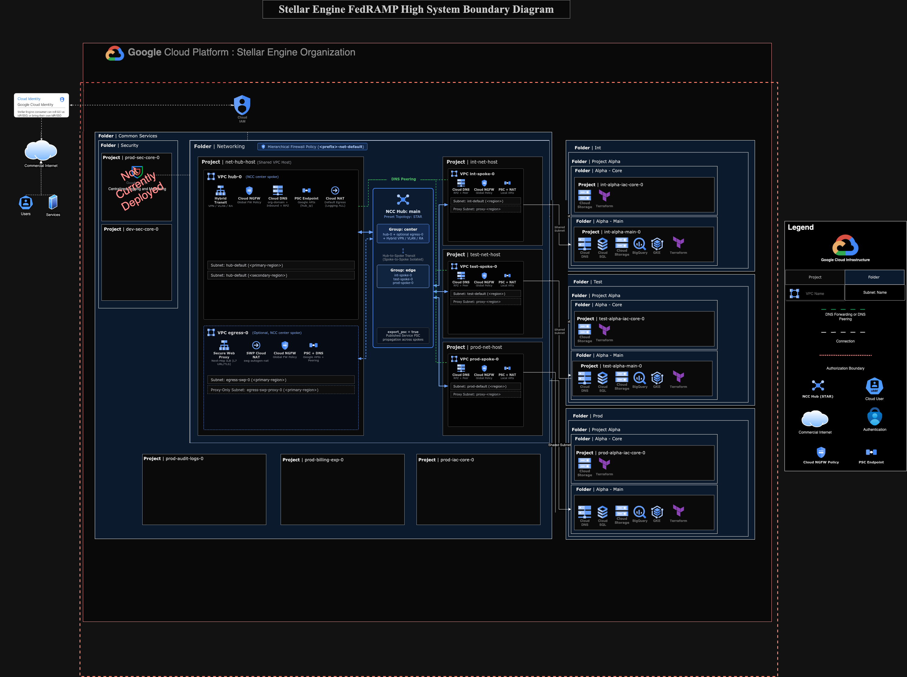

# FedRAMP High and Moderate Network

This stage deploys a hub-and-spoke network topology built on Network Connectivity Center for Assured Workloads environments targeting FedRAMP High, FedRAMP Moderate, and DoD Impact Level 2, including `IL2`.

## 1 Topology and regime coverage

Stage 2 provisions a central hub Shared VPC (`hub-0`) inside `<prefix>-net-hub-host` and connects environment spoke Shared VPCs (`<env>-spoke-0`) through a default `STAR` Network Connectivity Center hub (`main`).

- Placing `hub-0` in the `center` group and all environment spoke VPCs in the `edge` group enforces network segmentation across environments while allowing centralized DNS and hybrid transit through the hub project for NIST SP 800-53r5 SC-7 and AC-4 controls.
- Each environment spoke VPC includes a regional proxy-only subnet (`proxy_subnets`) so tenant projects can deploy regional Application Load Balancers with Cloud Armor WAF policies directly in spoke networks.
- Although the Stage 0 `FEDRAMP_MODERATE` organization policy template only denies `in:asia-east2-locations` and `in:global`, this networking stage is validated and supported for US regions (`in:us-locations`, such as `us-east4`, `us-west1`, and `us-central1`).
- Replace every `<region>` placeholder in the sample `terraform.tfvars` file with the `regions.primary` value from Stage 0, because the stage validates that the first tenant subnet of each environment uses that region.
- `IL2` workloads land on `2-networking-a-fedramp`, whereas `IL4` and `IL5` workloads use `2-networking-b-il5-ngfw` with Palo Alto VM-Series Next-Generation Firewalls in a three-VPC VDSS layout.

## 2 Firewall policy governance

Stage 2 combines a folder-level hierarchical firewall policy (`module.firewall-policy-default`) on the `Networking` folder with per-VPC global network firewall policies (`module.hub-firewall-policy`, `module.env-spoke-firewall-policy`, and `module.egress-firewall-policy`) attached to `hub-0`, each `<env>-spoke-0` VPC, and the optional `egress-0` VPC.

- Every Stage 2 VPC sets `firewall_policy_enforcement_order = "BEFORE_CLASSIC_FIREWALL"` so global network firewall policies evaluate after the folder hierarchical firewall policy and before any blueprint-local classic VPC firewall rules (`google_compute_firewall`) created by workload blueprints such as `blueprints/fedramp-high/postgresql`.
- Configure per-VPC ingress and egress rules inline through `firewall_policy_rules` or declaratively through YAML files under `data/firewall-policies/<vpc>-ingress.yaml` and `data/firewall-policies/<vpc>-egress.yaml`.
- Global network firewall policy rules support Cloud NGFW Essentials Layer 4 controls and IAM secure tags, Cloud NGFW Standard `fqdns`, `region_codes`, and `threat_intelligences` matchers, and Cloud NGFW Enterprise Layer 7 inspection (`action = "apply_security_profile_group"` with `security_profile_group_ids` and `tls_inspect`).
- When collecting CM-6 and SC-7 firewall evidence, inspect the folder hierarchical firewall policy (`gcloud compute firewall-policies rules list --firewall-policy=<policy-id> --organization=<org-id>`), each host-project global network firewall policy (`gcloud compute network-firewall-policies rules list --firewall-policy=<name> --global --project=<network-project-id>`), and any blueprint classic VPC firewall rules (`gcloud compute firewall-rules list --project=<network-project-id>`).

## 3 Private Google APIs access

When `psc_google_apis.enabled` is `true`, which is the default, the stage provisions a dedicated Private Service Connect endpoint (`modules/net-address`) targeting `all-apis` or `vpc-sc` inside `hub-0`, each `<env>-spoke-0` VPC, and the optional `egress-0` VPC.

- Private Service Connect endpoints for Google APIs are not transitive across Network Connectivity Center, so each spoke VPC receives its own internal endpoint IP (`10.255.255.10` and above by default), private `p.googleapis.com.` DNS zone, and `googleapis` Cloud DNS response policy (`private.googleapis.com.` and `restricted.googleapis.com.`) while peering `${organization.domain}.` to `hub-0`.
- Inbound DNS forwarding on `hub-0` resolves Google API domains to `psc_google_apis.hub_ip` (`10.255.255.1` by default) so on-premises networks connected through Cloud VPN or Cloud Interconnect can reach Google APIs privately when Cloud Router advertises that `/32` address.
- Setting `export_psc = true` on the `main` Network Connectivity Center hub propagates Private Service Connect endpoints for published producer services across spoke VPCs without requiring Private Services Access VPC peering; configure `psa_ranges` only for legacy services that do not use Private Service Connect.
- Set `psc_google_apis.enabled = false` only if you require legacy `199.36.153.8/30` and `199.36.153.4/30` Private Google Access routes and root `.` DNS peering to `hub-0`.

## 4 Centralized internet egress

Outbound internet egress defaults to distributed per-VPC Cloud NAT gateways (`enable_cloud_nat = true`, `centralized_egress.enabled = false`) because Network Connectivity Center VPC spokes exchange subnet routes only and do not transit `0.0.0.0/0` default routes.

- Set `centralized_egress.enabled = true` to deploy a dedicated `egress-0` VPC spoke in the `main` hub `center` group running Secure Web Proxy (`modules/net-swp`) in `NEXT_HOP_ROUTING_MODE` paired with a Cloud NAT gateway configured with `endpoint_types = ["ENDPOINT_TYPE_SWG"]`.
- Enabling `centralized_egress` replaces per-VPC Cloud NAT on `hub-0` and `<env>-spoke-0` with static `0.0.0.0/0` next-hop IP routes pointing to `centralized_egress.swp_ip` so outbound HTTP and HTTPS traffic traverses centralized URL lists and Layer 7 proxy rules.
- Define Secure Web Proxy URL lists and policy rules inline via `centralized_egress.url_lists` and `centralized_egress.policy_rules` or in YAML files under `data/swp-url-lists/` and `data/swp-policy-rules/`.

## 5 NCC hub factory

When `enable_default_ncc_hub` is `true`, which is the default, the stage provisions the `main` `STAR` hub inside `<prefix>-net-hub-host` with `center` and `edge` groups and attaches `hub-0`, optional `egress-0`, and every `<env>-spoke-0` VPC automatically. You can extend the `main` hub to attach Cloud VPN tunnels, Cloud Interconnect VLAN attachments, or router appliance spokes, or define additional hubs through YAML files under `data/ncc-hubs/` (`factories_config.ncc_hubs`) and through the `ncc_hubs` variable.

- Symbolic `$project_ids:<key>` references resolve Stage 2 host projects (`hub`, `hub-host`, `net-hub-host`, `prod`, `int`, `test`) and Stage 1 tenant projects.
- Symbolic `$vpcs:<key>` and `$networks:<key>` references resolve Stage 2 VPC networks (`hub`, optional `egress`, and each environment spoke).
- Symbolic `$locations:<key>`, `$ncc_hubs:<hub>`, and `$ncc_groups:<hub>/<group>` references resolve regions, hub IDs, and group IDs managed in the same stage.
- Set `enable_default_ncc_hub = false` only when replacing the built-in `main` hub with a custom hub layout.

```yaml
# yaml-language-server: $schema=../../schemas/ncc-hub.schema.json

name: main
spokes:
  tunnels:
    onprem-primary:
      location: $locations:primary
      group: $ncc_groups:main/center
      uris:
        - projects/my-hub-project/regions/us-east4/vpnTunnels/onprem-0
        - projects/my-hub-project/regions/us-east4/vpnTunnels/onprem-1
```

<p align="center">
  
</p>

<!-- BEGIN TOC -->
- [1 Topology and regime coverage](#1-topology-and-regime-coverage)
- [2 Firewall policy governance](#2-firewall-policy-governance)
- [3 Private Google APIs access](#3-private-google-apis-access)
- [4 Centralized internet egress](#4-centralized-internet-egress)
- [5 NCC hub factory](#5-ncc-hub-factory)
- [Variables](#variables)
- [Outputs](#outputs)
<!-- END TOC -->
<!-- BEGIN TFDOC -->
## Variables

| name | description | type | required | default |
|---|---|:---:|:---:|:---:|
| [alert_email](variables.tf#L17) | Email to receive log alerts. | <code>string</code> | ✓ |  |
| [automation](variables.tf#L33) | Automation resources created by the bootstrap stage. | <code title="object&#40;&#123;&#10;  outputs_bucket &#61; string&#10;&#125;&#41;">object&#40;&#123;&#8230;&#125;&#41;</code> | ✓ |  |
| [billing_account](variables.tf#L41) | Billing account id. If billing account is not part of the same org set `is_org_level` to false. | <code title="object&#40;&#123;&#10;  id           &#61; string&#10;  is_org_level &#61; optional&#40;bool, true&#41;&#10;&#125;&#41;">object&#40;&#123;&#8230;&#125;&#41;</code> | ✓ |  |
| [envs_folders](variables.tf#L159) | List of environments to be created for projects to go into. | <code title="map&#40;object&#40;&#123;&#10;  admin &#61; string&#10;&#125;&#41;&#41;">map&#40;object&#40;&#123;&#8230;&#125;&#41;&#41;</code> | ✓ |  |
| [folder_ids](variables.tf#L277) | Folders to be used for the networking resources in folders/nnnnnnnnnnn format. If null, folder will be created. | <code title="object&#40;&#123;&#10;  networking &#61; string&#10;  envs       &#61; optional&#40;map&#40;string&#41;&#41;&#10;&#125;&#41;">object&#40;&#123;&#8230;&#125;&#41;</code> | ✓ |  |
| [organization](variables.tf#L416) | Organization details. | <code title="object&#40;&#123;&#10;  domain      &#61; string&#10;  id          &#61; number&#10;  customer_id &#61; string&#10;&#125;&#41;">object&#40;&#123;&#8230;&#125;&#41;</code> | ✓ |  |
| [prefix](variables.tf#L432) | Prefix used for resources that need unique names. Use 9 characters or less. | <code>string</code> | ✓ |  |
| [regions](variables.tf#L495) | Region definitions. Inherited from 0-bootstrap outputs. Must be specified in bootstrap terraform.tfvars. | <code title="object&#40;&#123;&#10;  primary &#61; string&#10;&#125;&#41;">object&#40;&#123;&#8230;&#125;&#41;</code> | ✓ |  |
| [tenant_accounts](variables.tf#L563) | Base Tenant accounts that are created for each folder, provided as a combination of environment and tenant. | <code title="map&#40;object&#40;&#123;&#10;  tenant          &#61; string&#10;  env             &#61; string&#10;  main_project    &#61; string&#10;  admin_principal &#61; string&#10;&#125;&#41;&#41;">map&#40;object&#40;&#123;&#8230;&#125;&#41;&#41;</code> | ✓ |  |
| [assured_workloads](variables.tf#L22) | Configuration for Assured Workloads. | <code title="object&#40;&#123;&#10;  regime   &#61; optional&#40;string&#41;&#10;  location &#61; optional&#40;string&#41;&#10;  folder   &#61; optional&#40;string&#41;&#10;&#125;&#41;">object&#40;&#123;&#8230;&#125;&#41;</code> |  | <code>&#123;&#125;</code> |
| [billing_override](variables.tf#L54) | Optional billing override configuration. If set, disables service account impersonation for project billing linkage and runs under the user account using the specified quota projects. | <code title="object&#40;&#123;&#10;  project         &#61; string&#10;  billing_project &#61; string&#10;&#125;&#41;">object&#40;&#123;&#8230;&#125;&#41;</code> |  | <code>null</code> |
| [centralized_egress](variables.tf#L63) | Optional centralized Internet Egress VPC spoke running Secure Web Proxy in next-hop routing mode with Cloud NAT. | <code title="object&#40;&#123;&#10;  enabled           &#61; optional&#40;bool, false&#41;&#10;  subnet_cidr       &#61; optional&#40;string, &#34;10.64.250.0&#47;24&#34;&#41;&#10;  proxy_subnet_cidr &#61; optional&#40;string, &#34;10.64.251.0&#47;24&#34;&#41;&#10;  swp_ip            &#61; optional&#40;string, &#34;10.64.250.10&#34;&#41;&#10;  ports             &#61; optional&#40;list&#40;number&#41;, &#91;80, 443&#93;&#41;&#10;  certificates      &#61; optional&#40;list&#40;string&#41;, &#91;&#93;&#41;&#10;  policy_rules &#61; optional&#40;map&#40;object&#40;&#123;&#10;    priority            &#61; number&#10;    allow               &#61; optional&#40;bool, true&#41;&#10;    description         &#61; optional&#40;string&#41;&#10;    enabled             &#61; optional&#40;bool, true&#41;&#10;    application_matcher &#61; optional&#40;string&#41;&#10;    session_matcher     &#61; optional&#40;string&#41;&#10;    tls_inspect         &#61; optional&#40;bool&#41;&#10;    matcher_args &#61; optional&#40;object&#40;&#123;&#10;      application &#61; optional&#40;list&#40;string&#41;, &#91;&#93;&#41;&#10;      session     &#61; optional&#40;list&#40;string&#41;, &#91;&#93;&#41;&#10;    &#125;&#41;, &#123;&#125;&#41;&#10;  &#125;&#41;&#41;, &#123;&#125;&#41;&#10;  url_lists &#61; optional&#40;map&#40;object&#40;&#123;&#10;    values      &#61; list&#40;string&#41;&#10;    description &#61; optional&#40;string&#41;&#10;  &#125;&#41;&#41;, &#123;&#125;&#41;&#10;&#125;&#41;">object&#40;&#123;&#8230;&#125;&#41;</code> |  | <code>&#123;&#125;</code> |
| [cidrs](variables.tf#L100) | Named CIDR ranges to use in firewall policy rules. | <code>map&#40;list&#40;string&#41;&#41;</code> |  | <code>&#123;&#125;</code> |
| [common_services_folder](variables.tf#L107) | Common services folder ID. | <code>string</code> |  | <code>null</code> |
| [custom_roles](variables.tf#L113) | Custom roles defined at the org level, in key => id format. | <code title="object&#40;&#123;&#10;  service_project_network_admin &#61; string&#10;&#125;&#41;">object&#40;&#123;&#8230;&#125;&#41;</code> |  | <code>null</code> |
| [dns](variables.tf#L121) | DNS configuration. | <code title="object&#40;&#123;&#10;  enable_logging &#61; optional&#40;bool, true&#41; &#35; CIS Compliance Benchmark 2.12&#10;  resolvers      &#61; optional&#40;list&#40;string&#41;, &#91;&#93;&#41;&#10;&#125;&#41;">object&#40;&#123;&#8230;&#125;&#41;</code> |  | <code>&#123;&#125;</code> |
| [dns_policy_rules](variables.tf#L131) | DNS response policy rules in name => rule format. | <code title="map&#40;object&#40;&#123;&#10;  dns_name &#61; string&#10;  behavior &#61; optional&#40;string, &#34;bypassResponsePolicy&#34;&#41;&#10;  local_data &#61; optional&#40;map&#40;object&#40;&#123;&#10;    ttl     &#61; optional&#40;number&#41;&#10;    rrdatas &#61; optional&#40;list&#40;string&#41;, &#91;&#93;&#41;&#10;  &#125;&#41;&#41;, &#123;&#125;&#41;&#10;&#125;&#41;&#41;">map&#40;object&#40;&#123;&#8230;&#125;&#41;&#41;</code> |  | <code>&#123;&#125;</code> |
| [enable_cloud_nat](variables.tf#L145) | Enable per-VPC Cloud NAT and default internet gateway routes on the central hub VPC and environment spoke VPCs when centralized_egress.enabled is false. | <code>bool</code> |  | <code>true</code> |
| [enable_default_ncc_hub](variables.tf#L152) | Provision the default STAR-topology Network Connectivity Center hub connecting the central hub VPC (center group) and environment spoke VPCs (edge group). | <code>bool</code> |  | <code>true</code> |
| [essential_contacts](variables.tf#L166) | Email or map of emails to notification category lists used for essential contacts, unset if null or empty. | <code>any</code> |  | <code>&#123;&#125;</code> |
| [factories_config](variables.tf#L180) | Configuration for network resource factories. | <code title="object&#40;&#123;&#10;  data_dir              &#61; optional&#40;string, &#34;data&#34;&#41;&#10;  dns_policy_rules_file &#61; optional&#40;string, &#34;data&#47;dns-policy-rules.yaml&#34;&#41;&#10;  firewall_policy_name  &#61; optional&#40;string&#41;&#10;  ncc_hubs              &#61; optional&#40;string&#41;&#10;&#125;&#41;">object&#40;&#123;&#8230;&#125;&#41;</code> |  | <code title="&#123;&#10;  data_dir &#61; &#34;data&#34;&#10;&#125;">&#123;&#8230;&#125;</code> |
| [fast_features](variables.tf#L198) | FAST features enabled. | <code>any</code> |  | <code>null</code> |
| [firewall_policy_rules](variables.tf#L204) | Global network firewall policy rules keyed by VPC name (hub, egress, or environment spoke name), supporting Cloud NGFW Essentials, Standard, and Enterprise attributes. | <code title="map&#40;object&#40;&#123;&#10;  ingress &#61; optional&#40;map&#40;object&#40;&#123;&#10;    priority                &#61; number&#10;    action                  &#61; optional&#40;string, &#34;allow&#34;&#41;&#10;    description             &#61; optional&#40;string&#41;&#10;    disabled                &#61; optional&#40;bool, false&#41;&#10;    enable_logging          &#61; optional&#40;bool&#41;&#10;    security_profile_group  &#61; optional&#40;string&#41;&#10;    target_resources        &#61; optional&#40;list&#40;string&#41;&#41;&#10;    target_service_accounts &#61; optional&#40;list&#40;string&#41;&#41;&#10;    target_tags             &#61; optional&#40;list&#40;string&#41;&#41;&#10;    tls_inspect             &#61; optional&#40;bool, null&#41;&#10;    match &#61; object&#40;&#123;&#10;      address_groups       &#61; optional&#40;list&#40;string&#41;&#41;&#10;      fqdns                &#61; optional&#40;list&#40;string&#41;&#41;&#10;      region_codes         &#61; optional&#40;list&#40;string&#41;&#41;&#10;      threat_intelligences &#61; optional&#40;list&#40;string&#41;&#41;&#10;      destination_ranges   &#61; optional&#40;list&#40;string&#41;&#41;&#10;      source_ranges        &#61; optional&#40;list&#40;string&#41;&#41;&#10;      source_tags          &#61; optional&#40;list&#40;string&#41;&#41;&#10;      layer4_configs &#61; optional&#40;list&#40;object&#40;&#123;&#10;        protocol &#61; optional&#40;string, &#34;all&#34;&#41;&#10;        ports    &#61; optional&#40;list&#40;string&#41;&#41;&#10;      &#125;&#41;&#41;, &#91;&#123;&#125;&#93;&#41;&#10;    &#125;&#41;&#10;  &#125;&#41;&#41;, &#123;&#125;&#41;&#10;  egress &#61; optional&#40;map&#40;object&#40;&#123;&#10;    priority                &#61; number&#10;    action                  &#61; optional&#40;string, &#34;deny&#34;&#41;&#10;    description             &#61; optional&#40;string&#41;&#10;    disabled                &#61; optional&#40;bool, false&#41;&#10;    enable_logging          &#61; optional&#40;bool&#41;&#10;    security_profile_group  &#61; optional&#40;string&#41;&#10;    target_resources        &#61; optional&#40;list&#40;string&#41;&#41;&#10;    target_service_accounts &#61; optional&#40;list&#40;string&#41;&#41;&#10;    target_tags             &#61; optional&#40;list&#40;string&#41;&#41;&#10;    tls_inspect             &#61; optional&#40;bool, null&#41;&#10;    match &#61; object&#40;&#123;&#10;      address_groups       &#61; optional&#40;list&#40;string&#41;&#41;&#10;      fqdns                &#61; optional&#40;list&#40;string&#41;&#41;&#10;      region_codes         &#61; optional&#40;list&#40;string&#41;&#41;&#10;      threat_intelligences &#61; optional&#40;list&#40;string&#41;&#41;&#10;      destination_ranges   &#61; optional&#40;list&#40;string&#41;&#41;&#10;      source_ranges        &#61; optional&#40;list&#40;string&#41;&#41;&#10;      source_tags          &#61; optional&#40;list&#40;string&#41;&#41;&#10;      layer4_configs &#61; optional&#40;list&#40;object&#40;&#123;&#10;        protocol &#61; optional&#40;string, &#34;all&#34;&#41;&#10;        ports    &#61; optional&#40;list&#40;string&#41;&#41;&#10;      &#125;&#41;&#41;, &#91;&#123;&#125;&#93;&#41;&#10;    &#125;&#41;&#10;  &#125;&#41;&#41;, &#123;&#125;&#41;&#10;&#125;&#41;&#41;">map&#40;object&#40;&#123;&#8230;&#125;&#41;&#41;</code> |  | <code>&#123;&#125;</code> |
| [gcp_ranges](variables.tf#L286) | GCP address ranges in name => range format. | <code>map&#40;string&#41;</code> |  | <code title="&#123;&#10;  gcp_dev_primary  &#61; &#34;10.68.0.0&#47;16&#34;&#10;  gcp_hub_primary  &#61; &#34;10.200.0.0&#47;16&#34;&#10;  gcp_prod_primary &#61; &#34;10.72.0.0&#47;16&#34;&#10;&#125;">&#123;&#8230;&#125;</code> |
| [groups](variables.tf#L296) | IAM groups mapping. | <code>any</code> |  | <code>null</code> |
| [kms_protection_level](variables.tf#L302) | KMS protection level. | <code>string</code> |  | <code>null</code> |
| [logging](variables.tf#L310) | Logging configuration. | <code>any</code> |  | <code>null</code> |
| [ncc_hubs](variables.tf#L316) | Network Connectivity Center hubs, groups, and spokes in hub_name => config format, merged with YAML definitions from factories_config.ncc_hubs. | <code title="map&#40;object&#40;&#123;&#10;  project_id      &#61; optional&#40;string&#41;&#10;  description     &#61; optional&#40;string, &#34;Terraform-managed.&#34;&#41;&#10;  export_psc      &#61; optional&#40;bool, true&#41;&#10;  policy_mode     &#61; optional&#40;string&#41;&#10;  preset_topology &#61; optional&#40;string&#41;&#10;  labels          &#61; optional&#40;map&#40;string&#41;, &#123;&#125;&#41;&#10;  groups &#61; optional&#40;map&#40;object&#40;&#123;&#10;    description &#61; optional&#40;string, &#34;Terraform-managed.&#34;&#41;&#10;    labels      &#61; optional&#40;map&#40;string&#41;, &#123;&#125;&#41;&#10;    auto_accept &#61; optional&#40;list&#40;string&#41;, &#91;&#93;&#41;&#10;  &#125;&#41;&#41;, &#123;&#125;&#41;&#10;  spokes &#61; optional&#40;object&#40;&#123;&#10;    vpcs &#61; optional&#40;map&#40;object&#40;&#123;&#10;      vpc                   &#61; optional&#40;string&#41;&#10;      name                  &#61; optional&#40;string&#41;&#10;      project_id            &#61; optional&#40;string&#41;&#10;      group                 &#61; optional&#40;string&#41;&#10;      description           &#61; optional&#40;string, &#34;Terraform-managed.&#34;&#41;&#10;      labels                &#61; optional&#40;map&#40;string&#41;, &#123;&#125;&#41;&#10;      exclude_export_ranges &#61; optional&#40;list&#40;string&#41;&#41;&#10;      include_export_ranges &#61; optional&#40;list&#40;string&#41;&#41;&#10;    &#125;&#41;&#41;, &#123;&#125;&#41;&#10;    tunnels &#61; optional&#40;map&#40;object&#40;&#123;&#10;      uris                       &#61; list&#40;string&#41;&#10;      name                       &#61; optional&#40;string&#41;&#10;      location                   &#61; optional&#40;string&#41;&#10;      project_id                 &#61; optional&#40;string&#41;&#10;      group                      &#61; optional&#40;string&#41;&#10;      description                &#61; optional&#40;string, &#34;Terraform-managed.&#34;&#41;&#10;      labels                     &#61; optional&#40;map&#40;string&#41;, &#123;&#125;&#41;&#10;      site_to_site_data_transfer &#61; optional&#40;bool, true&#41;&#10;      include_import_ranges      &#61; optional&#40;list&#40;string&#41;, &#91;&#34;ALL_IPV4_RANGES&#34;&#93;&#41;&#10;    &#125;&#41;&#41;, &#123;&#125;&#41;&#10;    vlan_attachments &#61; optional&#40;map&#40;object&#40;&#123;&#10;      uris                       &#61; list&#40;string&#41;&#10;      name                       &#61; optional&#40;string&#41;&#10;      location                   &#61; optional&#40;string&#41;&#10;      project_id                 &#61; optional&#40;string&#41;&#10;      group                      &#61; optional&#40;string&#41;&#10;      description                &#61; optional&#40;string, &#34;Terraform-managed.&#34;&#41;&#10;      labels                     &#61; optional&#40;map&#40;string&#41;, &#123;&#125;&#41;&#10;      site_to_site_data_transfer &#61; optional&#40;bool, true&#41;&#10;      include_import_ranges      &#61; optional&#40;list&#40;string&#41;, &#91;&#34;ALL_IPV4_RANGES&#34;&#93;&#41;&#10;    &#125;&#41;&#41;, &#123;&#125;&#41;&#10;    router_appliances &#61; optional&#40;map&#40;object&#40;&#123;&#10;      instances &#61; list&#40;object&#40;&#123;&#10;        ip_address      &#61; string&#10;        virtual_machine &#61; string&#10;      &#125;&#41;&#41;&#10;      name                       &#61; optional&#40;string&#41;&#10;      location                   &#61; optional&#40;string&#41;&#10;      project_id                 &#61; optional&#40;string&#41;&#10;      group                      &#61; optional&#40;string&#41;&#10;      description                &#61; optional&#40;string, &#34;Terraform-managed.&#34;&#41;&#10;      labels                     &#61; optional&#40;map&#40;string&#41;, &#123;&#125;&#41;&#10;      site_to_site_data_transfer &#61; optional&#40;bool, true&#41;&#10;      include_import_ranges      &#61; optional&#40;list&#40;string&#41;, &#91;&#34;ALL_IPV4_RANGES&#34;&#93;&#41;&#10;    &#125;&#41;&#41;, &#123;&#125;&#41;&#10;  &#125;&#41;, &#123;&#125;&#41;&#10;&#125;&#41;&#41;">map&#40;object&#40;&#123;&#8230;&#125;&#41;&#41;</code> |  | <code>&#123;&#125;</code> |
| [outputs_location](variables.tf#L426) | Path where providers and tfvars files for the following stages are written. Leave empty to disable. | <code>string</code> |  | <code>null</code> |
| [proxy_subnets](variables.tf#L443) | VPC proxy-only subnet CIDRs keyed by environment. One entry per key of envs_folders is required: every environment spoke gets a proxy-only subnet in regions.primary. | <code>map&#40;string&#41;</code> |  | <code>&#123;&#125;</code> |
| [psa_ranges](variables.tf#L456) | Optional Private Services Access (PSA) IP ranges keyed by environment name (for example prod, int, or test) for services that do not use Private Service Connect. | <code title="map&#40;list&#40;object&#40;&#123;&#10;  deletion_policy  &#61; optional&#40;string&#41;&#10;  ranges           &#61; map&#40;string&#41;&#10;  labels           &#61; optional&#40;map&#40;string&#41;, &#123;&#125;&#41;&#10;  export_routes    &#61; optional&#40;bool, false&#41;&#10;  import_routes    &#61; optional&#40;bool, false&#41;&#10;  peered_domains   &#61; optional&#40;list&#40;string&#41;, &#91;&#93;&#41;&#10;  range_prefix     &#61; optional&#40;string&#41;&#10;  service_producer &#61; optional&#40;string, &#34;servicenetworking.googleapis.com&#34;&#41;&#10;&#125;&#41;&#41;&#41;">map&#40;list&#40;object&#40;&#123;&#8230;&#125;&#41;&#41;&#41;</code> |  | <code>&#123;&#125;</code> |
| [psc_google_apis](variables.tf#L472) | Private Service Connect endpoints for Google APIs created in the central hub VPC, environment spoke VPCs, and optional centralized egress VPC. | <code title="object&#40;&#123;&#10;  enabled   &#61; optional&#40;bool, true&#41;&#10;  bundle    &#61; optional&#40;string, &#34;all-apis&#34;&#41;&#10;  hub_ip    &#61; optional&#40;string, &#34;10.255.255.1&#34;&#41;&#10;  egress_ip &#61; optional&#40;string, &#34;10.255.255.2&#34;&#41;&#10;  spoke_ips &#61; optional&#40;map&#40;string&#41;, &#123;&#125;&#41;&#10;&#125;&#41;">object&#40;&#123;&#8230;&#125;&#41;</code> |  | <code>&#123;&#125;</code> |
| [regime_mapping](variables.tf#L489) | Compliance regime shorthand mapping. | <code>any</code> |  | <code>null</code> |
| [security_profile_group_ids](variables.tf#L504) | Optional Cloud NGFW Enterprise security profile group IDs in logical_key => //networksecurity.googleapis.com/<id> format. | <code>map&#40;string&#41;</code> |  | <code>&#123;&#125;</code> |
| [service_accounts](variables.tf#L511) | Automation service accounts in name => email format. | <code title="object&#40;&#123;&#10;  data-platform-dev    &#61; string&#10;  data-platform-prod   &#61; string&#10;  gke-dev              &#61; string&#10;  gke-prod             &#61; string&#10;  project-factory-dev  &#61; string&#10;  project-factory-prod &#61; string&#10;&#125;&#41;">object&#40;&#123;&#8230;&#125;&#41;</code> |  | <code>null</code> |
| [spoke_project_iam](variables.tf#L525) | Additional authoritative IAM bindings for environment spoke host projects, keyed by environment name (for example dev or prod) and role. | <code>map&#40;map&#40;list&#40;string&#41;&#41;&#41;</code> |  | <code>&#123;&#125;</code> |
| [subnets](variables.tf#L532) | VPC subnet configurations keyed by network name. | <code title="map&#40;list&#40;object&#40;&#123;&#10;  name                             &#61; string&#10;  ip_cidr_range                    &#61; string&#10;  region                           &#61; string&#10;  description                      &#61; optional&#40;string&#41;&#10;  enable_private_access            &#61; optional&#40;bool, true&#41;&#10;  allow_subnet_cidr_routes_overlap &#61; optional&#40;bool&#41;&#10;  flow_logs_config &#61; optional&#40;object&#40;&#123;&#10;    aggregation_interval &#61; optional&#40;string&#41;&#10;    filter_expression    &#61; optional&#40;string&#41;&#10;    flow_sampling        &#61; optional&#40;number&#41;&#10;    metadata             &#61; optional&#40;string&#41;&#10;    metadata_fields      &#61; optional&#40;list&#40;string&#41;&#41;&#10;  &#125;&#41;&#41;&#10;  secondary_ip_ranges &#61; optional&#40;map&#40;string&#41;&#41;&#10;  iam                 &#61; optional&#40;map&#40;list&#40;string&#41;&#41;, &#123;&#125;&#41;&#10;  tenant              &#61; optional&#40;string&#41;&#10;&#125;&#41;&#41;&#41;">map&#40;list&#40;object&#40;&#123;&#8230;&#125;&#41;&#41;&#41;</code> |  | <code>&#123;&#125;</code> |

## Outputs

| name | description | sensitive |
|---|---|:---:|
| [host_project_ids](outputs.tf#L108) | Network project ids. |  |
| [host_project_numbers](outputs.tf#L113) | Network project numbers. |  |
| [hub](outputs.tf#L118) | Central hub host project, VPC, and optional SWP egress identifiers. |  |
| [ncc_groups](outputs.tf#L123) | Network Connectivity Center group IDs keyed by hub/group. |  |
| [ncc_hubs](outputs.tf#L128) | Network Connectivity Center hub IDs keyed by hub name. |  |
| [ncc_spokes](outputs.tf#L133) | Network Connectivity Center spoke IDs grouped by spoke type. |  |
| [psc_google_apis_endpoints](outputs.tf#L138) | Per-VPC Private Service Connect Google APIs endpoint addresses and forwarding rules. |  |
| [tfvars](outputs.tf#L143) | Terraform variables file for the following stages. | ✓ |
<!-- END TFDOC -->
