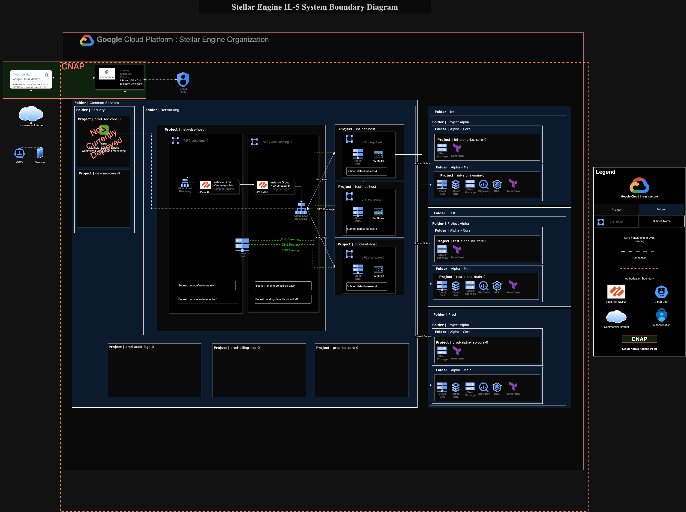

# Networking with network virtual appliances

Stage 2 deploys centralized hub-and-spoke Shared VPC infrastructure inspected by Network Virtual Appliances between the landing and DMZ zones for IL4 and IL5 Assured Workloads environments:

- The landing hub VPC centralizes connectivity to on-premises networks, spoke VPCs, and shared services such as CI/CD, repositories, and monitoring.
- Environment spoke VPCs isolate workloads per environment while preserving controlled transit to central services.
- Dedicated Shared VPC host projects separate network administration from workload service projects.
- Cloud DNS peering and forwarding zones centralize hybrid and internal name resolution across the hub and spokes.

[VPC network peering](https://cloud.google.com/vpc/docs/vpc-peering) connects the landing hub VPC to environment spoke VPCs with full bandwidth and low latency. Customize subnet counts and CIDR allocations through Terraform variables or YAML factory files without modifying module code.

<p align="center">
  
</p>

<!-- BEGIN TOC -->
- [1 Design overview](#1-design-overview)
  - [Palo Alto NGFW](#palo-alto-ngfw)
  - [Multi-regional deployment](#multi-regional-deployment)
  - [VPC design](#vpc-design)
  - [Internal connectivity](#internal-connectivity)
  - [IP addressing and routing](#ip-addressing-and-routing)
  - [Internet egress](#internet-egress)
  - [VPC and hierarchical firewalls](#vpc-and-hierarchical-firewalls)
  - [DNS design](#dns-design)
- [2 Stage file layout](#2-stage-file-layout)
  - [VPCs](#vpcs)
  - [VPNs](#vpns)
  - [Routing and BGP](#routing-and-bgp)
  - [Firewalls](#firewalls)
  - [DNS architecture](#dns-architecture)
    - [Cloud environment](#cloud-environment)
- [3 Stage deployment](#3-stage-deployment)
  - [Provider and variable files](#provider-and-variable-files)
  - [Service account impersonation](#service-account-impersonation)
  - [Default gcloud project](#default-gcloud-project)
  - [Variable configuration](#variable-configuration)
  - [Delayed billing association](#delayed-billing-association)
  - [Terraform execution](#terraform-execution)
    - [Private Google Access](#private-google-access)
- [4 Customizations](#4-customizations)
  - [Default regions](#default-regions)
  - [Network Connectivity Center transit](#network-connectivity-center-transit)
  - [Per-VPC Private Service Connect](#per-vpc-private-service-connect)
  - [Hybrid Cloud DNS forwarding](#hybrid-cloud-dns-forwarding)
  - [NGFW health checks and load balancers](#ngfw-health-checks-and-load-balancers)
  - [NGFW STIG hardening and secrets](#ngfw-stig-hardening-and-secrets)
- [5 Palo Alto NGFW configuration](#5-palo-alto-ngfw-configuration)
  - [Management console access](#management-console-access)
  - [Bootstrap XML updates](#bootstrap-xml-updates)
- [6 Redeployment](#6-redeployment)
- [Variables](#variables)
- [Outputs](#outputs)
<!-- END TOC -->

## 1 Design overview

### Palo Alto NGFW

This stage deploys Palo Alto VM-Series Next-Generation Firewalls to provide intrusion detection, intrusion prevention, and TLS inspection for IL4 and IL5 accreditations.

### Multi-regional deployment

Configure the `regions` variable to deploy regional NVA instance templates, managed instance groups, internal load balancers, and test VMs into one or two Assured Workloads regions supported for IL4 or IL5. Weigh the operational cost of running dual-region firewall appliances against your availability requirements when selecting single-region versus multi-region topology.

### VPC design

The central VDSS inspection boundary separates traffic across two transit VPC networks connected by regional multi-zone [Managed Instance Groups](https://cloud.google.com/compute/docs/instance-groups) of Palo Alto VM-Series appliances fronted by regional internal passthrough Network Load Balancers:

- The landing VPC serves as the trusted hub peered with environment spoke VPCs and terminates Cloud VPN tunnels from on-premises networks.
- The DMZ VPC serves as the untrusted boundary towards the public internet and hosts [Cloud NAT](https://cloud.google.com/nat/docs/overview) when enabled.
- Cross-environment traffic and north-south traffic between landing and DMZ networks traverse the NVA appliances, which come up unlicensed for initial routing and NAT bootstrap until you apply production licenses and security policies.
- Outbound traffic from landing networks to DMZ networks undergoes source NAT on the NVAs unless excluded by policy.

Each VPC operates as a [Shared VPC](https://cloud.google.com/vpc/docs/shared-vpc) in a dedicated host project so organization administrators retain central control over subnets, routes, and firewalls while delegating workload deployment to service project administrators. Environment spoke definitions flow directly from `0-bootstrap` and `1-resman`, and you can extend spokes across single-organization or multi-organization layouts.

### Internal connectivity

Environment spokes peer directly with the landing hub VPC while multi-NIC appliances bridge the landing and DMZ VPCs:

- [VPC Network Peering](https://cloud.google.com/vpc/docs/vpc-peering) connects the landing VPC to spoke VPCs with zero per-GB transit cost, full line-rate bandwidth, and no added latency, though peering is non-transitive, exchanges all subnet routes without granular filtering, and shares peering-group quotas.
- [Multi-NIC NVA appliances](https://cloud.google.com/architecture/best-practices-vpc-design#multi-nic) connect the landing and DMZ VPCs to enforce Layer 7 IPS inspection and vendor policy parity with on-premises firewalls, trading off higher VM and licensing costs, VM throughput ceilings, and HA failover management.

### IP addressing and routing

Plan your cloud IP address space up front so routes aggregate into larger CIDR blocks and stay well within [Cloud Router](https://cloud.google.com/network-connectivity/docs/router/quotas) and [VPC](https://cloud.google.com/vpc/docs/quota) quotas.

By default, this stage partitions a `/11` CIDR block (`10.64.0.0/11`) into eight `/16` blocks across configured regions for landing DMZ, landing hub, development, and production zones. Within each `/16` block, the first `/24` allocates a default subnet and the final three `/24` ranges stay available for [Private Services Access](https://cloud.google.com/vpc/docs/private-services-access) via `psa_ranges` or [Internal Application Load Balancer](https://cloud.google.com/load-balancing/docs/l7-internal) proxy-only subnets.

The `<prefix>-net-vdss-host` project hosts three VDSS networks alongside one peered spoke VPC per `<env>` host project from `1-resman`:

| name | description |
| --- | --- |
| `vdss-mgmt-0` | Management network for the Palo Alto NGFW appliances and bastion host. |
| `vdss-dmz-0` | Internet-facing untrusted DMZ network. |
| `vdss-landing-0` | Trusted landing hub network peered with environment spoke VPCs. |

Default VDSS subnets allocate from the primary region:

| name | region | VPC network | CIDR |
| --- | --- | --- | --- |
| `mgmt-default` | `<primary-region>` | `prod-mgmt-0` | `10.64.128.0/24` |
| `dmz-default` | `<primary-region>` | `prod-dmz-0` | `10.64.128.0/24` |
| `landing-default` | `<primary-region>` | `prod-landing-0` | `10.64.0.0/24` |

Each environment spoke VPC also receives a workload subnet and a regional proxy-only subnet.

Routing combines automatic subnet routes, VPC peering route exchange, tagged static routes, and [Cloud Router](https://cloud.google.com/network-connectivity/docs/router#docs) BGP advertisements:

- Subnets within the same VPC exchange routes automatically.
- Environment spoke VPCs and the landing hub VPC exchange subnet routes over VPC peering.
- Tagged static routes in spoke VPCs steer cross-environment, on-premises, and internet traffic from regional VMs to the regional NVA internal load balancer VIP as next hop.
- Static routes on the NVA trusted interface return traffic to every spoke primary subnet, secondary subnet range, and proxy-only subnet. Because the NVAs hold a default route on the DMZ interface only, a reply to any spoke range missing a static route exits through the DMZ. Private Services Access ranges have no static route because VPC peering is not transitive.
- Cloud Routers attached to landing VPC VPN gateways disable default subnet advertisements and advertise aggregated CIDR blocks through custom advertisements to conserve route quotas.

### Internet egress

Outbound internet traffic traverses a NAT policy from the landing zone to the DMZ zone on the Palo Alto NGFW. Set `enable_cloud_nat = true` to enable [Cloud NAT](https://cloud.google.com/nat/docs/overview) in the DMZ VPC, which defaults to disabled. You can also adapt the design for per-VPC Cloud NAT, explicit forwarding proxies with URL filtering, or hairpinned egress through on-premises firewalls.

### VPC and hierarchical firewalls

Stage 2 combines folder-level hierarchical firewall policies on the `Networking` folder for baseline ingress rules such as load balancer health checks and Identity-Aware Proxy TCP forwarding with per-VPC firewall rules defined in YAML factory files.

### DNS design

Cloud DNS policies and peering zones support bidirectional hybrid and cloud name resolution:

- Private zones and an [inbound server policy](https://cloud.google.com/dns/docs/server-policies-overview#dns-server-policy-in) resolve cloud domains for on-premises resolvers, while forwarding zones send `onprem.example.com` queries to on-premises DNS servers.
- The landing hub hosts on-premises forwarding zones, Google API zones, and the top-level private zone (`gcp.example.com`).
- Environment spoke projects host environment subdomains such as `prod.gcp.example.com` using [cross-project binding](https://cloud.google.com/dns/docs/zones/zones-overview#cross-project_binding) and delegate root `.` resolution to the landing hub via DNS peering.
- [Cloud DNS response policies](https://cloud.google.com/dns/docs/zones/manage-response-policies#create-response-policy-rule) resolve [Private Google Access domains](https://cloud.google.com/vpc/docs/configure-private-google-access#domain-options) privately.

Route `35.199.192.0/19` from on-premises networks into the Cloud VPN tunnels and forward `private.googleapis.com`, `restricted.googleapis.com`, and your cloud domain such as `gcp.example.com` to the landing inbound DNS addresses.

## 2 Stage file layout

### VPCs

Separate `vpc-*.tf` files define the landing and DMZ VDSS networks and environment spoke networks:

- The [`project`](../../../modules/project) module provisions each [Shared VPC host project](https://cloud.google.com/vpc/docs/shared-vpc) and enables required APIs.
- The [`net-vpc`](../../../modules/net-vpc) module manages subnets from `data/subnets/`, Private Google Access routes, landing DNS inbound policies, and [Private Services Access](https://cloud.google.com/vpc/docs/configure-private-services-access#allocating-range) ranges via `psa_ranges`, falling back to a default `/22` `default-peering` range when `psa_ranges` is unset for an environment.
- The [`net-cloudnat`](../../../modules/net-cloudnat) module provisions Cloud NAT for outbound internet egress in the DMZ VPC.

### VPNs

The `vpn-onprem.tf` file configures HA VPN connectivity through the [`net-vpn-ha`](../../../modules/net-vpn-ha) module between on-premises networks and the landing VPC using `vpn_onprem_primary_config` and `vpn_onprem_secondary_config`.

### Routing and BGP

Each [`net-vpc`](../../../modules/net-vpc) call in `vpc-*.tf` manages static routes alongside dynamic routes learned via VPC peering and BGP sessions configured through `vpn_onprem_configs`.

### Firewalls

Per-VPC firewall rules use [`net-vpc-firewall`](../../../modules/net-vpc-firewall) YAML factories under `data/firewall-rules/dmz/` and `data/firewall-rules/landing/`, following the [rules factory documentation](../../../modules/net-vpc-firewall#rules-factory).

Folder-level hierarchical firewall policies in `main.tf` attach to the `Networking` folder via [`folder`](../../../modules/folder) and [`net-firewall-policy`](../../../modules/net-firewall-policy/README.md#factory) using rules in `data/hierarchical-ingress-rules.yaml`.

### DNS architecture

Files matching `dns-*.tf` configure [`dns`](../../../modules/dns) zones for on-premises forwarding, the root cloud domain (`gcp.example.com`), and environment subdomains (`dev.gcp.example.com` and `prod.gcp.example.com`).

#### Cloud environment

The root DNS zone in the landing host project serves as the central resolver for spoke VPCs through root DNS peering (`prod-landing-root-dns-peering`). Grant visibility to both the landing and DMZ VPCs when adding spoke private zones (`prod-dns-private-zone`) so the entire cloud network can resolve them.

## 3 Stage deployment

Deploy this stage after [0-bootstrap](../0-bootstrap) and [1-resman](../1-resman) so the Stage 2 automation service account, state bucket, and upstream `.auto.tfvars.json` files exist.

### Provider and variable files

Stage 2 consumes generated provider and `.auto.tfvars.json` files from [Stage 0 and Stage 1](../0-bootstrap/README.md). Run `stage-links.sh` from the FAST root directory with your Stage 0 outputs bucket or local outputs path to print the `gcloud storage cp` commands:

```bash
../../stage-links.sh gs://xxx-prod-iac-core-outputs-0
```

Copy the generated provider and variable files into the stage directory:

```bash
gcloud alpha storage cp gs://xxx-prod-iac-core-outputs-0/providers/2-networking-providers.tf ./
gcloud alpha storage cp gs://xxx-prod-iac-core-outputs-0/tfvars/0-globals.auto.tfvars.json ./
gcloud alpha storage cp gs://xxx-prod-iac-core-outputs-0/tfvars/0-bootstrap.auto.tfvars.json ./
gcloud alpha storage cp gs://xxx-prod-iac-core-outputs-0/tfvars/1-resman.auto.tfvars.json ./
```

### Service account impersonation

The generated provider file impersonates the Stage 2 automation service account. Ensure your active user identity belongs to `gcp-devops` or `organization-admins`.

### Default gcloud project

Set your default `gcloud` project to the Stage 0 automation project before running Terraform manually from the command line.

Look up the automation project ID from Stage 0 outputs:

```bash
cd ../0-bootstrap
terraform output project_ids
```

Configure the default project in `gcloud` and return to the Stage 2 directory:

```bash
gcloud config set project <prefix>-prod-iac-core-0
cd ../2-networking-b-il5-ngfw
```

### Variable configuration

Stage 2 inputs fall into three groups:

- Organization-wide globals populated from `0-globals.auto.tfvars.json`.
- Upstream stage resource identifiers populated from `0-bootstrap.auto.tfvars.json` and `1-resman.auto.tfvars.json`.
- Stage-specific customizations set in `terraform.tfvars`, documented in [Customizations](#4-customizations) and the [Variables](#variables) table.

To write downstream stage output files to a local directory, set `outputs_location` in `terraform.tfvars`:

```tfvars
outputs_location = "~/fast-config"
```

### Delayed billing association

Delayed billing linkage is unsupported for production and intended only for development environments where Terraform cannot attach billing accounts directly:

- Set `billing_account.id` to `null` temporarily in `0-globals.auto.tfvars.json`.
- Target each project resource (`dev-spoke-project`, `landing-project`, `prod-spoke-project`) individually and untaint it if needed:
  `terraform apply -target 'module.landing-project.google_project.project[0]'`
  `terraform untaint 'module.landing-project.google_project.project[0]'`
- Link the billing account to the created projects manually.
- Restore `billing_account.id` in `0-globals.auto.tfvars.json` and run `terraform apply`.

### Terraform execution

Initialize and apply the stage once provider and variable files are in place:

```bash
terraform init
terraform plan
terraform apply
```

#### Private Google Access

[Private Google Access](https://cloud.google.com/vpc/docs/private-google-access) comes preconfigured across Stage 2:

- Cloud DNS response policies in the landing project resolve supported Google API domains to Private Google Access VIPs.
- Static routes for `private.googleapis.com` and `restricted.googleapis.com` VIP ranges exist on every VPC except the DMZ VPC.
- Advertise the Private Google Access VIP ranges through custom router or tunnel advertisements on `vpn_onprem_primary_config` and `vpn_onprem_secondary_config` to enable private Google API access from on-premises networks.

## 4 Customizations

### Default regions

The `regions` variable maps `regions.primary` to a Google Cloud region. Replace every `<region>` placeholder in `terraform.tfvars` with the `regions.primary` value from Stage 0:

- Update the region values in `regions` to match your target Assured Workloads regions.
- Keep `landing-default`, `dmz-default`, and `mgmt-default` in `regions.primary` because the NGFW instance templates and bootstrap configuration look up those subnets by primary region.

### Network Connectivity Center transit

Set `transit_mode = "ncc"` to replace classic VPC network peering between environment spokes and the landing hub with a STAR-topology Network Connectivity Center hub (`main`) inside the VDSS host project:

- Leaving `transit_mode` at its default value `peering` preserves existing VPC peering between environment spokes and `vdss-landing-0`.
- Setting `transit_mode = "ncc"` enables `networkconnectivity.googleapis.com`, places `vdss-landing-0` in the `center` group and every `<env>-spoke-0` VPC in the `edge` group, and skips classic peering resources (`module.peering-envs` and `time_sleep.peering_delay`).
- Because NCC VPC spokes exchange subnet routes only and do not propagate custom static routes, `transit_mode = "ncc"` creates one `0.0.0.0/0` `google_compute_route` per environment spoke (`google_compute_route.ncc_spoke_default`) with `next_hop_ilb` set to the IPv4 VIP of `module.ilb-nva-vdss["primary"]` after spoke attachment completes.
- Switching `transit_mode` from `peering` to `ncc` destroys classic VPC peerings before attaching NCC VPC spokes; if reverting from `ncc` to `peering`, apply a two-step transition by removing the NCC VPC spokes first before re-enabling VPC peering.
- Extend the `main` hub or define additional hubs through `ncc_hubs` or YAML files under `data/ncc-hubs/` using `factories_config.ncc_hubs` and `schemas/ncc-hub.schema.json`.
- Plan-time validations and lifecycle preconditions require explicit project IDs in `auto_accept`, reject wildcard `*` auto-accept entries, and prevent `vdss-mgmt-0` from attaching to a data-plane NCC hub.

### Per-VPC Private Service Connect

Set `psc_google_apis.enabled = true` to provision per-VPC Private Service Connect endpoints for Google APIs targeting `vpc-sc` by default or `all-apis`, avoiding NGFW source NAT hairpinning for Google API traffic:

- Each environment spoke VPC and `vdss-landing-0` receives its own PSC forwarding rule (`modules/net-address`) and Cloud DNS response policy (`data/dns-policy-rules.yaml`) setting `accounts.google.com.` to `bypassResponsePolicy`.
- Service Directory registration defaults to `regions.primary` when `psc_google_apis.service_directory_registration` or its `region` is unset so single-region Assured Workloads enclaves avoid Google Cloud's implicit `us-central1` fallback.
- Under the default `bundle = "vpc-sc"`, the per-VPC response policies map `restricted.googleapis.com.` and VPC-SC Google API domains to the local PSC IP while setting `private.googleapis.com.` and non-VPC-SC domains (`dl.google.com`, `*.gstatic.com`, `packages.cloud.google.com`, `source.developers.google.com`) to `bypassResponsePolicy` because the `vpc-sc` bundle rejects non-VPC-SC services. Reach `dl.google.com` or `packages.cloud.google.com` by switching to `bundle = "all-apis"` or routing them through an explicit egress proxy or NGFW policy.
- Enabling per-VPC PSC removes legacy `199.36.153.4/30` and `199.36.153.8/30` Google API routes from `vdss-landing-0` and spoke VPCs, scopes `landing-dns-policy-googleapis` to `vdss-landing-0`, and attaches a dedicated Private Google Access response policy (`module.vdss-mgmt-dmz-dns-policy-googleapis`) to `vdss-mgmt-0` and `vdss-dmz-0` after detaching them from `landing-dns-policy-googleapis` so `management-bastion` and NGFW bootstrap keep resolving Google APIs privately via `199.36.153.4/30` (`vpc-sc`) or `199.36.153.8/30` (`all-apis`).
- Enabling `psc_google_apis.enabled = true` on a brownfield deployment triggers a ForceNew replacement of each spoke's root `.` DNS peering zone (`module.env-dns-peer-landing-root`) with `${organization.domain}.`, causing a brief DNS interruption during apply and dropping automatic peering for custom private DNS zones outside `${organization.domain}.` and `dns_forwarding_zones` unless you add dedicated peering zones for them.
- Environment keys in `envs_folders` must produce unique 20-character PSC forwarding rule names when `psc_google_apis.enabled` is `true`.

### Hybrid Cloud DNS forwarding

Configure `dns_forwarding_zones` to create Cloud DNS forwarding zones in the VDSS host project for on-premises or cross-cloud domains:

- Every zone domain must end with a trailing dot and cannot be the root domain `.` because a root forwarding zone breaks Compute Engine internal DNS resolution.
- Every forwarder map key must be a valid IPv4 address paired with a `forwarding_path` of `default` or `private`.
- When `psc_google_apis.enabled` is `true`, each environment spoke also receives a DNS peering zone to `vdss-landing-0` for every configured forwarding domain so spokes keep resolving hybrid names.

### NGFW health checks and load balancers

Customize dataplane probing and load balancer failover behavior with `ngfw_health_check` and `ngfw_ilb_config`:

- By default, `ngfw_health_check` probes TCP port 22 with `enable_logging = null`, preserving `false` on the managed instance group and `true` on the internal load balancers for zero-diff upgrades. Set `enable_logging` explicitly to `true` or `false` to override logging on both the managed instance group and internal load balancers.
- Before switching `ngfw_health_check.protocol = "HTTPS"` with port 443 and `request_path = "/unauth/php/health.php"`, add TCP port 443 ingress firewall rules from `cidrs.healthchecks` on both `vdss` (`landing`) and `dmz` VPCs. Applying HTTPS health checks without TCP port 443 firewall rules causes Google health check probes to fail and mark every NGFW backend unhealthy.
- Set `ngfw_ilb_config.persist_conn_on_unhealthy = "NEVER_PERSIST"` with optional `connection_draining_timeout_sec` and `failover_config` to drop stale sessions when an NGFW instance fails health checks.
- Set `ngfw_ilb_config.trusted_static_ips` and `ngfw_ilb_config.untrusted_static_ips` keyed by region name or alias to reserve deterministic internal VIPs through `modules/net-address`.

### NGFW STIG hardening and secrets

Configure DISA STIG bootstrap defaults and write-only Secret Manager storage with `ngfw_stig_config` and `ngfw_admin_password_secret`:

- Leaving `ngfw_stig_config = null` preserves legacy bootstrap defaults (`minimum-length` 12, `US/Pacific` timezone, and no login banner) with byte-for-byte parity in rendered `bootstrap.xml` and `init-cfg.txt`.
- Setting `ngfw_stig_config` enforces a `min_password_length` of at least 16, defaults `timezone` to `UTC`, and renders an XML-escaped `login_banner` with acknowledgment when provided.
- PAN-OS VM-Series FIPS-CC mode cannot be enabled through `init-cfg.txt`. Enable FIPS-CC mode post-boot through the PAN-OS CLI (`debug fips-cc on`) or the Maintenance Recovery Tool (MRT); activation triggers a factory reset and requires re-applying a FIPS-compliant running configuration.
- Setting `ngfw_admin_password_secret.enabled = true` stores the generated administrator password in a regional CMEK-encrypted Secret Manager secret (`ngfw-admin-password` by default) using write-only secret versions (`wo_version`) and returns `null` from the legacy `ngfw_password` output. Although `wo_version` avoids a second copy in Secret Manager version state, `random_password.password` remains in Terraform state, so treat the Terraform state bucket as sensitive and restrict access strictly.

## 5 Palo Alto NGFW configuration

### Management console access

Gather three prerequisites to reach the Palo Alto web management console:

1. Retrieve the initial administrator password from Terraform outputs with `terraform output -json | jq ".ngfw_password.value.result"`, or from Secret Manager with `gcloud secrets versions access latest --secret=ngfw-admin-password --location=<region> --project=<vdss-host-project-id>` when `ngfw_admin_password_secret.enabled` is `true`.
2. Start the `management-bastion` VM on the management network if it is stopped.
3. Target the second network interface (`nic1`) attached to `prod-mgmt-0`, which is the only NGFW interface enabled for administration.

Open an Identity-Aware Proxy SSH tunnel through `management-bastion` in its deployed `<ZONE>`, which you can look up with `terraform show | grep zone`:

```bash
gcloud compute ssh management-bastion --zone <ZONE> --tunnel-through-iap -- -L 8443:<ip-of-ngfw>:443
```

Sign in at `https://localhost:8443/` with username `admin` and the password from Terraform outputs or Secret Manager.

To connect to the NGFW over SSH from `management-bastion`, fetch the SSH private key from Secret Manager on the bastion host:

```bash
mkdir -p ~/.ssh && gcloud secrets versions access latest --secret=ngfw-ssh-private-key --project=<vdss-host-project-id> > ~/.ssh/id_rsa && chmod 600 ~/.ssh/id_rsa
```

### Bootstrap XML updates

After changing firewall settings in the Palo Alto console, export the running configuration archive from the Device Operations tab to extract `running-config.xml`, then merge your changes back into `templates/bootstrap.xml.tpl` while preserving the Terraform template expressions:

- `password_hash` and `min_password_length` appear under `mgt-config` near the top of `templates/bootstrap.xml.tpl`.
- `ssh_pubkey` appears twice, once near the top and once under `initcfg`.
- `healthcheck_cidrs`, `iap_cidrs`, and `enable_https_healthcheck` render inside the `ssh-healthcheck` interface management profile.
- `return_routes` and `lz_gateway_ip` wrap the static-route template loop from `%{ for` to `%{ endfor`.
- `timezone` and `login_banner` appear under `deviceconfig` and `system`.

Terraform builds `return_routes` from every spoke subnet, secondary range, and proxy-only subnet, and the NGFW instance template tracks the hash of the rendered `bootstrap.xml` file. Adding or removing a spoke range causes the next `terraform apply` to create a new instance template and replace running NGFW instances through the managed instance group, dropping active connections on replaced instances and discarding any live NGFW changes not merged into `templates/bootstrap.xml.tpl`.

## 6 Redeployment

Run `pre-redeploy.sh` before redeploying this stage with the same `prefix` to import retained resources cleanly.
<!-- BEGIN TFDOC -->
## Variables

| name | description | type | required | default |
|---|---|:---:|:---:|:---:|
| [alert_email](variables.tf#L17) | Email to receive log alerts. | <code>string</code> | ✓ |  |
| [automation](variables.tf#L33) | Automation resources created by the bootstrap stage. | <code>object&#40;&#123;&#8230;&#125;&#41;</code> | ✓ |  |
| [billing_account](variables.tf#L41) | Billing account id. If billing account is not part of the same org set `is_org_level` to false. | <code>object&#40;&#123;&#8230;&#125;&#41;</code> | ✓ |  |
| [envs_folders](variables.tf#L145) | List of environments to be created for projects to go into. | <code>map&#40;object&#40;&#123;&#8230;&#125;&#41;&#41;</code> | ✓ |  |
| [folder_ids](variables.tf#L221) | Folders to be used for the networking resources in folders/nnnnnnnnnnn format. If null, folder will be created. | <code>object&#40;&#123;&#8230;&#125;&#41;</code> | ✓ |  |
| [organization](variables.tf#L507) | Organization details. | <code>object&#40;&#123;&#8230;&#125;&#41;</code> | ✓ |  |
| [prefix](variables.tf#L523) | Prefix used for resources that need unique names. Use 9 characters or less. | <code>string</code> | ✓ |  |
| [regions](variables.tf#L607) | Region definitions. Inherited from 0-bootstrap outputs. Must be specified in bootstrap terraform.tfvars. | <code>object&#40;&#123;&#8230;&#125;&#41;</code> | ✓ |  |
| [tenant_accounts](variables.tf#L684) | Base Tenant accounts that are created for each folder, provided as a combination of environment and tenant. | <code>map&#40;object&#40;&#123;&#8230;&#125;&#41;&#41;</code> | ✓ |  |
| [assured_workloads](variables.tf#L22) | Configuration for Assured Workloads. | <code>object&#40;&#123;&#8230;&#125;&#41;</code> |  | <code>&#123;&#125;</code> |
| [billing_override](variables.tf#L54) | Optional billing override configuration. If set, disables service account impersonation for project billing linkage and runs under the user account using the specified quota projects. | <code>object&#40;&#123;&#8230;&#125;&#41;</code> |  | <code>null</code> |
| [cidrs](variables.tf#L63) | Named CIDR ranges to use in firewall rules. | <code>map&#40;list&#40;string&#41;&#41;</code> |  | <code>&#123;&#125;</code> |
| [common_services_folder](variables.tf#L70) | Common services folder ID. | <code>string</code> |  | <code>null</code> |
| [custom_roles](variables.tf#L76) | Custom roles defined at the org level, in key => id format. | <code>object&#40;&#123;&#8230;&#125;&#41;</code> |  | <code>null</code> |
| [dns](variables.tf#L85) | DNS configuration. | <code>object&#40;&#123;&#8230;&#125;&#41;</code> |  | <code>&#123;&#125;</code> |
| [dns_forwarding_zones](variables.tf#L95) | Optional hybrid Cloud DNS forwarding zones created in the VDSS host project, keyed by zone name suffix. Root domain '.' is forbidden because it breaks Compute Engine internal DNS. | <code>map&#40;object&#40;&#123;&#8230;&#125;&#41;&#41;</code> |  | <code>&#123;&#125;</code> |
| [dns_policy_rules](variables.tf#L131) | DNS response policy rules in name => rule format. | <code>map&#40;object&#40;&#123;&#8230;&#125;&#41;&#41;</code> |  | <code>&#123;&#125;</code> |
| [essential_contacts](variables.tf#L152) | Email or map of emails to notification category lists used for essential contacts, unset if null or empty. | <code>any</code> |  | <code>&#123;&#125;</code> |
| [factories_config](variables.tf#L166) | Configuration for network resource factories. | <code>object&#40;&#123;&#8230;&#125;&#41;</code> |  | <code>&#123;&#8230;&#125;</code> |
| [fast_features](variables.tf#L184) | FAST features enabled. | <code>any</code> |  | <code>null</code> |
| [firewall_rules](variables.tf#L190) | Firewall rules for each VPC / environment spoke. | <code>map&#40;object&#40;&#123;&#8230;&#125;&#41;&#41;</code> |  | <code>&#123;&#125;</code> |
| [force_destroy](variables.tf#L230) | Toggles force_destroy for GCS buckets. | <code>bool</code> |  | <code>false</code> |
| [groups](variables.tf#L236) | IAM groups mapping. | <code>any</code> |  | <code>null</code> |
| [kms_protection_level](variables.tf#L242) | KMS protection level. | <code>string</code> |  | <code>null</code> |
| [logging](variables.tf#L250) | Logging configuration. | <code>any</code> |  | <code>null</code> |
| [ncc_hubs](variables.tf#L256) | Network Connectivity Center hubs, groups, and spokes in hub_name => config format, merged with YAML definitions from factories_config.ncc_hubs. | <code>map&#40;object&#40;&#123;&#8230;&#125;&#41;&#41;</code> |  | <code>&#123;&#125;</code> |
| [ngfw_admin_password_secret](variables.tf#L383) | Optional regional CMEK-encrypted Secret Manager secret storing the NGFW administrator password using write-only secret versions. When enabled, the legacy ngfw_password output returns null. | <code>object&#40;&#123;&#8230;&#125;&#41;</code> |  | <code>&#123;&#125;</code> |
| [ngfw_health_check](variables.tf#L411) | Health check configuration for NGFW managed instance groups and internal load balancers. Defaults to TCP port 22 for backward compatibility; set protocol to HTTPS with port 443 and request_path /unauth/php/health.php for dataplane health probing after adding TCP/443 health check firewall rules on landing and dmz. | <code>object&#40;&#123;&#8230;&#125;&#41;</code> |  | <code>&#123;&#125;</code> |
| [ngfw_ilb_config](variables.tf#L446) | Optional internal passthrough load balancer hardening and static VIP configuration for the NGFW trusted landing and untrusted DMZ frontends. | <code>object&#40;&#123;&#8230;&#125;&#41;</code> |  | <code>&#123;&#125;</code> |
| [ngfw_stig_config](variables.tf#L483) | Optional DISA STIG hardening settings for the Palo Alto NGFW bootstrap XML template. Leave null to keep legacy defaults. FIPS-CC mode requires post-boot CLI or MRT activation rather than bootstrap files. | <code>object&#40;&#123;&#8230;&#125;&#41;</code> |  | <code>null</code> |
| [outputs_location](variables.tf#L517) | Path where providers and tfvars files for the following stages are written. Leave empty to disable. | <code>string</code> |  | <code>null</code> |
| [proxy_subnets](variables.tf#L534) | VPC proxy-only subnet CIDRs keyed by environment. | <code>map&#40;string&#41;</code> |  | <code>&#123;&#125;</code> |
| [psa_ranges](variables.tf#L541) | IP ranges used for Private Service Access (e.g. CloudSQL). Ranges is in name => range format. | <code>object&#40;&#123;&#8230;&#125;&#41;</code> |  | <code>&#123;&#125;</code> |
| [psc_google_apis](variables.tf#L561) | Optional per-VPC Private Service Connect endpoints for Google APIs created in the landing hub VPC and environment spoke VPCs. Defaults Service Directory registration to regions.primary when service_directory_registration or its region is unset. | <code>object&#40;&#123;&#8230;&#125;&#41;</code> |  | <code>&#123;&#125;</code> |
| [regime_mapping](variables.tf#L601) | Compliance regime shorthand mapping. | <code>any</code> |  | <code>null</code> |
| [service_accounts](variables.tf#L615) | Automation service accounts in name => email format. | <code>object&#40;&#123;&#8230;&#125;&#41;</code> |  | <code>null</code> |
| [spoke_project_iam](variables.tf#L629) | Additional authoritative IAM bindings for environment spoke host projects, keyed by environment name (for example dev or prod) and role. | <code>map&#40;map&#40;list&#40;string&#41;&#41;&#41;</code> |  | <code>&#123;&#125;</code> |
| [subnets](variables.tf#L636) | VPC subnet configurations keyed by network name. | <code>map&#40;list&#40;object&#40;&#123;&#8230;&#125;&#41;&#41;&#41;</code> |  | <code>&#123;&#125;</code> |
| [transit_mode](variables.tf#L695) | Spoke-to-landing transit mode: peering for classic VPC peering or ncc for Network Connectivity Center. | <code>string</code> |  | <code>&#34;peering&#34;</code> |
| [vmseries_image](variables.tf#L709) | The image name from which to boot an instance, including a license type (bundle/flex) and version. | <code>string</code> |  | <code>&#34;vmseries-112&#34;</code> |

## Outputs

| name | description | sensitive |
|---|---|:---:|
| [dns_forwarding_zones](outputs.tf#L123) | Optional hybrid Cloud DNS forwarding zones created in the VDSS host project. |  |
| [host_project_ids](outputs.tf#L128) | Network project ids. |  |
| [host_project_numbers](outputs.tf#L133) | Network project numbers. |  |
| [ncc_groups](outputs.tf#L138) | Network Connectivity Center group IDs keyed by hub/group. |  |
| [ncc_hubs](outputs.tf#L143) | Network Connectivity Center hub IDs keyed by hub name. |  |
| [ncc_spokes](outputs.tf#L148) | Network Connectivity Center spoke IDs grouped by spoke type. |  |
| [ngfw_admin_password_secret_id](outputs.tf#L153) | Regional Secret Manager secret ID storing the NGFW administrator password when ngfw_admin_password_secret.enabled is true. |  |
| [ngfw_password](outputs.tf#L161) | Password for authenticating to the NGFW. Returns null when ngfw_admin_password_secret.enabled is true. | ✓ |
| [ngfw_ssh_private_key_secret_id](outputs.tf#L167) | Secret Manager secret ID storing the NGFW SSH private key. |  |
| [psc_google_apis_endpoints](outputs.tf#L172) | Per-VPC Private Service Connect Google APIs endpoint addresses and forwarding rules. |  |
| [tfvars](outputs.tf#L177) | Terraform variables file for the following stages. | ✓ |
<!-- END TFDOC -->
